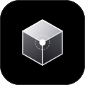

<div align="center">
  
  <h1>Autonomic AI — Website & Documentation</h1>
  <p><b>The official website, documentation, and registry for Autonomic AI.</b></p>
  <p><i>Built with SvelteKit 2, Svelte 5 runes, Tailwind CSS v4, and Framer Motion.</i></p>

  <p>
    <a href="https://autonomic-ai.dev"></a>
    <a href="https://github.com/autonomic-ai-dev/agent-brain"></a>
    <a href="https://github.com/autonomic-ai-dev/agent-spine"></a>
    <a href="https://autonomic-ai.openstatus.dev"></a>
  </p>
</div>

---

## Overview

This repository powers the official public web presence and documentation portal for **Autonomic AI** ([autonomic-ai.dev](https://autonomic-ai.dev)).

* **Landing Experience**: Minimalist, high-contrast DevEx inspired by Resend and Vercel, featuring a 3D perspective floor, Framer Motion scroll reactivity, and an interactive developer avionics console.
* **Documentation Hub**: Complete flag-level specifications for `agent-brain`, `agent-spine`, AGSTACK engineering invariants, Garry Tan review workflows (`gstack`), and deterministic `.verify/` harnesses.
* **Registry & Inspector**: Interactive browser for discoverable skills, agent recipes, and declarative YAML workflow manifests.

---

## Tech Stack

* **Framework**: SvelteKit 2 with Svelte 5 Runes (`$state`, `$derived`, `$effect`, `$props`)
* **Styling**: Tailwind CSS v4 with custom dark DevEx palette
* **Animation**: Framer Motion (`motion`) scroll observer & reactive horizon beams
* **Diagrams**: Monochromatic Mermaid.js embedded diagrams with zoom inspection modals
* **Markdown**: MDSveX with syntax highlighting and auto-extracted table of contents
* **Deployment**: Vercel Edge Network via `@sveltejs/adapter-vercel`

---

## Local Development

```bash
# Clone the repository
git clone https://github.com/autonomic-ai-dev/website.git
cd website

# Install dependencies
npm install

# Start development server
npm run dev
```

Visit `http://localhost:5173/` in your browser.

---

## Quality Gates & Verification

```bash
# Type-check with svelte-check
npm run check

# Create production build
npm run build

# Preview production build locally
npm run preview
```

---

<div align="center">
  <sub>© 2026 Autonomic AI. The Cognitive Governor & Procedure Graph for Autonomous Coding Agents.</sub>
</div>
