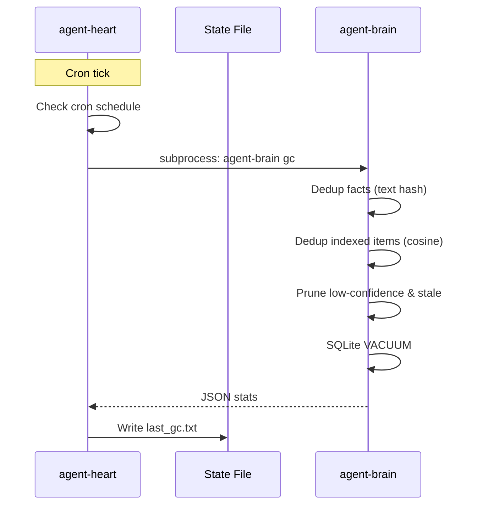

# agent-heart: Core Architecture & Concept

`agent-heart` is a lightweight background daemon built in Rust. It serves as the cron-driven maintenance pulse for the Autonomic AI ecosystem — running scheduled `agent-brain gc` passes and exposing MCP tools for on-demand triggers.

## 1. Background GC Scheduler (v0.1.0)

agent-brain's memory and index store accumulates redundant, stale, and low-confidence entries over time. agent-heart automates cleanup by running `agent-brain gc` on a configurable cron schedule.

**Implementation Details:**
- **Scheduling:** `tokio-cron-scheduler` — configurable cron expression (default: `0 3 * * *`, daily at 3 AM)
- **Delegation:** Thin subprocess call to `agent-brain gc --min-confidence 0.3 --max-age-days 90`
- **State:** Writes `last_gc.txt` timestamp to `$STATE_DIR/agent-heart/` on each successful run

### What agent-brain gc does

| Operation | Method |
|-----------|--------|
| Dedup facts | Text hash comparison within same topic |
| Dedup indexed items | Cosine similarity on embeddings (threshold > 0.95) |
| Prune low-confidence | Facts with `confidence < min_confidence` (default 0.3) |
| Prune stale index | Orphaned index entries with no matching fact |
| Compaction | SQLite `VACUUM` to reclaim space |

## 2. MCP Server (v0.1.0)

agent-heart exposes a stdio MCP server with two tools, compatible with any MCP host (Cursor, Claude Code, OpenCode, etc.):

| Tool | Description |
|------|-------------|
| `heart_trigger_gc` | Run GC with optional `min_confidence` and `max_age_days` |
| `heart_status` | Show daemon version, last GC time, current time |

## 3. Subprocess Brain Client

agent-heart does **not** link against agent-brain as a library. It discovers the `agent-brain` binary at runtime and runs it as a subprocess:

1. Check `config.brain.binary_path`
2. Check well-known paths (`/usr/local/bin/`, `/opt/homebrew/bin/`)
3. Run `which agent-brain`
4. Check `$HOME/.cargo/bin/agent-brain`

This keeps both binaries independently deployable and versioned.

## Roadmap

| Feature | Status | Notes |
|---------|--------|-------|
| Cron GC scheduler | ✅ v0.1.0 | Delegates to agent-brain gc |
| MCP server | ✅ v0.1.0 | heart_trigger_gc + heart_status |
| Installation scripts | 🔧 v0.1.0 | install.sh, CI pipeline |
| Omnichannel ingestion (agent-mouth) | 🔜 Planned | Slack, email, webhook ingestion |
| Advanced distillation | 🔜 Future | Semantic cluster summarization |

## Design Principles

1. **Thin scheduler** — agent-heart delegates, never owns domain logic
2. **Subprocess over library** — independent deploy, no dependency coupling
3. **Minimal surface** — cron + MCP, nothing more
