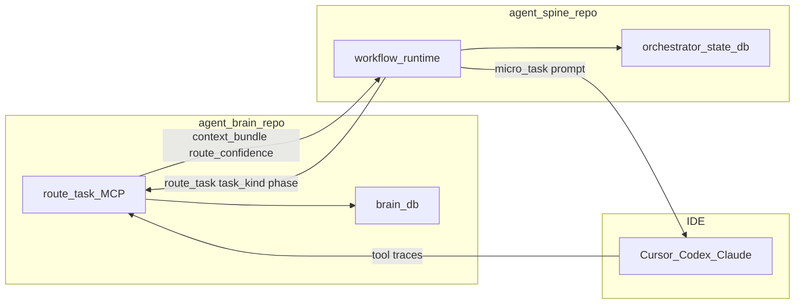

# Next-Level Roadmap: agent-spine (Orchestrator)

Strategic reference for the `agent-spine` execution engine and workflow structure.

---

## Philosophy

| Layer | Owner | Role |
|-------|-------|------|
| **Structure** | agent-spine | Break work into micro-tasks, track state, HITL, escalation |
| **Execution** | IDE (Cursor, Codex, Claude) | Write code, run tools — "Rust is the brain; IDE is the hands" |

---

## Split-repo integration

**Rules:**

- `orchestrator_state.db` = workflow runs, edge transitions — no duplicate facts.
- Orchestrator pins `agent-brain >= 0.23` and reads contract doc.

---

## Workflow Routing Strategy

To prevent users from writing a new YAML file for every task, the ecosystem supports a dynamic routing strategy:

1. **Universal Default Workflow**: For ~90% of tasks, a single generalized pipeline (e.g., `universal-developer.yaml`) handles execution (`Plan -> Write -> Test -> Review`). The user payload dictates the specific behavior, not the graph structure.
2. **Dynamic Routing (Meta-Router)**: For specialized tasks (e.g., `heavy-database-migration.yaml`), a lightweight "Meta-Agent" or script pings `agent-brain` with the user prompt. `agent-brain` uses its context routing to map the intent to the correct specialized workflow file before execution begins.
3. **Sub-Graph Routing**: Workflows can contain a "Router" node that injects state variables (e.g., `{"task_type": "frontend"}`), allowing subsequent edges to dynamically branch down specific sub-graphs based on the task type.

---

## Phased roadmap

### agent-orchestrator v0.1 — MVP

- Rust CLI: `orchestrator run|status|rewind|doctor`.
- YAML workflow schema (nodes, edges, phase, task_kind, hitl).
- MCP client to agent-brain.
- SQLite state + immutable transition log (time-travel debug).

### agent-orchestrator v0.2 — Supervisor

- IDE briefing hook (active node, required `task_kind`).
- HITL pause on low `route_confidence` or verification failures.
- Workflow templates (e.g. plan → implement → verify).

---

## 80/20 hybrid model (realistic expectations)

**Local stack fixes (information + structure):**

- Hallucinated APIs / wrong framework choices
- Context drift mid-task
- Mechanical errors (types, lint, test failures)
- Routine implementation against existing patterns

**Still needs frontier or HITL (deep intelligence):**

- Ambiguous architecture from vague requirements
- Subtle cross-file race conditions / distributed bugs
- Novel system design without reference patterns

Orchestrator + agent-brain **raise the floor** for 7B/8k models; they do not remove the ceiling.

---

## Future Evolution Visions

Beyond the immediate MVP roadmap, the following features represent the ultimate evolution of `agent-spine` as a high-performance execution engine:

### 1. Dynamic State-Based Routing
**The Vision:** Move beyond static YAML edges (`from: A, to: B`).
**The Evolution:** Support conditional branches based on state. For example: `if state.test_coverage < 80%: go to "write_tests" else: "deploy"`. This allows the workflow to adapt dynamically.

### 2. Model Escalation Policies
**The Vision:** Prevent free models from getting stuck in infinite failure loops.
**The Evolution:** Build a policy engine where if a node fails its retry limit, `agent-spine` pauses, dynamically swaps the engine to a Frontier Model (like Claude 3.5 Sonnet), and retries the exact same step with higher intelligence.

### 3. Observability Web UI / Streaming Dashboard
**The Vision:** Terminal execution makes parallel branches hard to visualize.
**The Evolution:** Attach a lightweight `axum` web server. When running a workflow, open a browser at `localhost:3000` to see a live-updating visual graph (like LangSmith) showing executing nodes, failures, and pending human approvals.

### 4. Distributed Kubernetes Execution
**The Vision:** All `tokio` tasks currently run on the local machine.
**The Evolution:** For enterprise workloads, dispatch specific nodes (like running a heavy integration test suite) as isolated Docker containers or Kubernetes jobs, natively orchestrated by `agent-spine`.

### 5. Unified Ecosystem Installer
**The Vision:** Installing two separate repositories (`agent-brain` and `agent-spine`) creates friction for new users.
**The Evolution:** Rather than coupling the binaries directly, provide a single universal bash installer (e.g., `curl -sL https://install.agent-ecosystem.sh | bash`) that installs both binaries and automatically bridges them over MCP.

### 6. Self-Updating Orchestrator (Auto-Update)
**The Vision:** Users shouldn't have to manually pull from GitHub or run `cargo install` to get the latest performance optimizations or workflow features for `agent-spine`.
**The Evolution:** Implement a background auto-update thread (similar to what `agent-brain` already has) that periodically checks for new releases of the `agent-spine` binary and safely upgrades itself between workflow runs.

### 7. Data Hydration (Pre-fetching Context)
**The Vision:** Models waste tokens and time figuring out how to run CLI tools to get context.
**The Evolution:** Build a "Hydrator" node in `agent-spine`. Before the AI agent wakes up, the Hydrator runs static tools (e.g., `cargo test`, `git diff`) and injects the raw output into the state payload, allowing the model to start with the exact error logs immediately.

### 8. Multi-Agent Debate & "The Critic"
**The Vision:** Small models struggle to generate perfect code on the first try but are excellent at critiquing.
**The Evolution:** Design workflows where Model A (The Coder) writes the implementation and passes it to Model B (The Critic). The Critic's only job is to aggressively find security flaws or bugs. If issues are found, the workflow routes back to the Coder.

### 9. Sandboxed Hypothesizing
**The Vision:** Give the model a safe playground to test assumptions before modifying the core system.
**The Evolution:** Add a workflow node that spins up a lightweight, isolated Docker container. The model can write "scratchpad" scripts to verify API behaviors inside the sandbox. Only when the scratchpad test passes does the model move on to the actual implementation.

---

## Default Workflow Library (Out-of-the-box)

To ensure `agent-spine` delivers massive value on day one, it will ship with the following default YAML workflows:

1. **The Universal Developer (`universal-developer.yaml`)**
   - **Flow:** Hydrate Context ➔ Plan ➔ Write Code ➔ Run Tests & Lint ➔ (Loop if fail) ➔ Human Approval Gate.
2. **The Database Migrator (`database-migration.yaml`)**
   - **Flow:** Analyze Schema ➔ Write SQL/ORM ➔ Spin up Sandbox DB ➔ Apply ➔ Rollback Test ➔ Human Approval Gate.
3. **The Security Patcher (`security-patcher.yaml`)**
   - **Flow:** Run Audit ➔ Bump Package ➔ Run Test Suite ➔ (If breaking changes: Fix Callers ➔ Re-test) ➔ Open PR.
4. **The Deep Code Reviewer (`deep-code-review.yaml`)**
   - **Flow:** Fan-out to 3 parallel critics (Security, Performance, Style) ➔ Fan-in Aggregator ➔ Generate Unified PR Comments.
5. **The Brutal Refactor (`brutal-refactor.yaml`)**
   - **Flow:** AST Search ➔ Draft New Interface ➔ Batch Update Callers ➔ Run Typechecker ➔ Loop until 0 errors ➔ Approval Gate.

### Tier 3: Complex Reasoning & Architectural Workflows (System 2 Thinking)

For highly ambiguous system design tasks, `agent-spine` forces the AI to explore multiple paths, weigh trade-offs, and generate formal documentation before writing code.

6. **The System Architect (`system-architect.yaml`)**
   - **Flow:** Gather Context (via `agent-brain`) ➔ Ideate 3 Alternative Architectures ➔ Fan-Out Evaluation (Cost vs. Latency vs. Maintainability) ➔ Fan-In Aggregator (Pick Winner) ➔ Draft Architecture Decision Record (ADR) ➔ Human Approval Gate ➔ Scaffolding Generation.
7. **The API Contract Negotiator (`api-design.yaml`)**
   - **Flow:** Draft OpenAPI Spec ➔ Route to Parallel Simulated Personas (Mobile Dev, Backend Dev, Security Eng) ➔ Refine Spec based on debate ➔ Human Approval Gate ➔ Generate Server Stubs & Client SDKs.
8. **The Incident Detective (`root-cause-analysis.yaml`)**
   - **Flow:** Hydrate Server Logs ➔ Generate 3 Error Hypotheses ➔ Spin up Parallel Sandboxes ➔ Write & Execute Reproduction Scripts for each hypothesis ➔ Identify Root Cause ➔ Draft Fix & Post-Mortem.

---

## The Information vs. Execution Synergy (Brain + Spine)

To prevent hardcoding intelligence into the orchestrator, `agent-spine` strictly relies on `agent-brain` as its "Librarian":

- **Dynamic Subagents:** When a workflow node requires a specialized subagent (e.g., "The Performance Critic"), `agent-spine` queries `agent-brain` to retrieve the latest system prompt from the user's `AGENTS.md` registry.
- **Dynamic Skills:** When a node needs to execute a tool (e.g., "Deploy to AWS"), `agent-spine` queries `agent-brain` for the correct `SKILL.md` syntax before executing the headless LLM call.

This synergy guarantees that workflows remain lightweight execution graphs, while all specialized knowledge, skills, and subagent personas remain centrally managed, versioned, and indexed by `agent-brain`.

---

## The Local Benchmarking Framework (Continuous Evaluation)

To ensure workflows and context retrieval are actually improving performance, we need a way to benchmark the ecosystem cheaply and continuously, without relying on expensive CI runners or API calls to frontier models.

### The Dockerized Micro-Model Strategy
- **The Engine:** Use `Ollama` running inside a lightweight local Docker container.
- **The Model:** Target a sub-4B parameter model (e.g., `phi3:mini` or `qwen2.5:1.5b`) quantized to 4-bit. This guarantees it can run entirely on an 8GB RAM Windows Intel machine without a dedicated GPU.
- **The Harness:** `agent-spine` executes a standardized suite of tasks (e.g., "Fix this syntax error", "Generate a migration") using the micro-model.
- **The Validation:** A test script validates the output (e.g., checking if the generated code compiles, or if the correct `agent-brain` context was successfully injected). 

If these utilities can make a tiny 1.5B model write working code, it proves the structural logic of `agent-spine` and `agent-brain` is mathematically sound!
