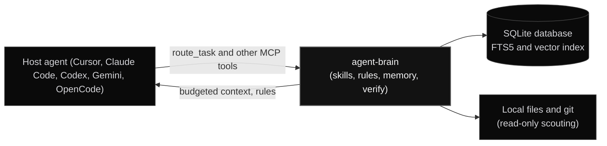

# agent-brain architecture

agent-brain is one local program. It runs as an MCP server for your editor, keeps its data in a SQLite database on your machine, and answers each turn from local files. It does not call a model.

## Components

| Component | Responsibility | Storage |
| :--- | :--- | :--- |
| Stdio MCP server (`agent-brain serve`) | Receives tool calls from the editor. A proxy forwards them to one background daemon that owns the database. | None of its own |
| Router (`route_task`) | Ranks skills, rules and memory for the prompt, and packs them within a token budget. | Reads the index |
| Index | Keyword search with BM25 over SQLite FTS5, and vector search over embeddings. | SQLite database |
| Gates | In hosts with hooks, block unrouted tools and risky shell commands before they run. | Route and outcome records |
| Verify | Runs allowlisted commands, records the outcome against the current commit, and produces receipts. | Verify records |
| Procedures | Records verified sequences of steps, and recalls them ranked by task fit and past success. | Procedure graph |
| Dashboard and stats | Reports measured counts from the local database. Estimates are labelled. | Read from the database |

## How a turn is answered

1. The host calls `route_task` with the prompt, the working directory and the open files.
2. The prompt is embedded with the local all-MiniLM-L6-v2 model, a 384-dimension vector. A keyword match runs over the same indexed items. The two rankings are fused.
3. Items are packed in rank order until the budget for the task kind is full. The budgets are 350 tokens for verification, 550 for review, 600 for implementing, 650 for debugging and 700 for architecture.
4. The response lists the skills, rules and memory chosen, and any must-apply rules that verified outcomes have promoted.

Index search switches from a plain scan to an approximate nearest-neighbour graph once the index holds more than 256 items.

## Trust levels for verify

A verify outcome gets a trust level from the way it was run. Only trusted outcomes can promote a recipe or count toward a receipt that the stop gate accepts.

| Source | How it is run | Trust |
| :--- | :--- | :--- |
| `orchestrator` | `agent-brain verify --source orchestrator -- <cmd>` | Trusted |
| `cli` | `agent-brain verify -- <cmd>`, for an allowlisted command | Trusted when allowlisted |
| `hook` | A shell capture hook | Observational |
| `mcp` | `record_verify_outcome`, reported by the agent | Advisory only |

## Storage and network

- **Data:** the database, settings and logs are in the home directory, `~/.autonomic/memory` by default. `AGENT_BRAIN_HOME` changes it.
- **Model calls:** none. The embedding model runs locally.
- **Network:** used only when you turn on an option that needs it, such as auto-update, git or cloud sync, `learn_from_url`, or package and registry commands. The [configuration](/docs/configuration) page lists these settings.

## Where to read more

- [How agent-brain works](/docs/concepts) follows one turn in detail.
- [MCP tools](/docs/mcp-tools) lists every tool the server advertises.
- [Design decisions](/docs/decisions) explains why these choices were made.
