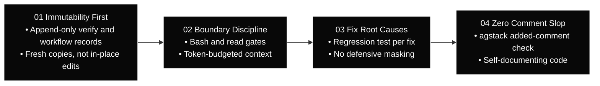

<div id="hero" class="space-y-4 not-prose mb-8">
  <div class="inline-flex items-center gap-2 px-3 py-1 rounded-full bg-white/[0.04] border border-white/10 text-xs font-mono text-neutral-300">
    <span class="w-1.5 h-1.5 rounded-full bg-white"></span>
    <span>Architectural Specification — Core Invariants</span>
  </div>

  <h1 class="text-3xl sm:text-4xl lg:text-5xl font-headline font-semibold tracking-tight text-white leading-[1.15]">
    The Engineering Invariants We Follow
  </h1>

  <p class="text-base sm:text-lg text-neutral-300 font-body leading-relaxed max-w-3xl">
    The engineering rules behind agstack and agent-brain. Each one lists the runtime behaviour the product has, and the rules the repositories follow. Where a rule is policy, the page says so.
  </p>
</div>

---

<section id="invariants-overview" class="my-10">

## Architectural Invariants Pipeline



</section>

---

<section id="immutability-first" class="my-10">

## 01. Immutability First

<div class="not-prose my-4 p-4 rounded-xl bg-neutral-950 border border-white/10 flex items-center justify-between">
  <span class="font-mono text-xs font-semibold text-white uppercase tracking-wider">Fingerprint Pillar</span>
  <span class="font-mono text-xs text-neutral-400">SHA-256 Proof Sealing</span>
</div>

Workflow steps and verify runs are recorded as they happen, and the record is not edited afterwards. Code changes that were not verified are shown as not verified.

### Runtime Guarantees
* **Deterministic Checkpointing**: `agent-spine` writes workflow step states to a local SQLite database. Snapshots are appended, not updated in place.
* **Content Addressing**: `agent-brain verify` records a SHA-256 hash of the code tree it tested with each run, in the local brain database.
* **State Immutability**: Functions must return fresh data copies rather than mutating shared runtime state references in-place.

</section>

---

<section id="boundary-discipline" class="my-10">

## 02. Boundary Discipline

<div class="not-prose my-4 p-4 rounded-xl bg-neutral-950 border border-white/10 flex items-center justify-between">
  <span class="font-mono text-xs font-semibold text-white uppercase tracking-wider">Gate Pillar</span>
  <span class="font-mono text-xs text-neutral-400">Bash and read gates</span>
</div>

Where a host supports hooks, agent-brain's bash gate blocks unsafe shell commands, and its read gate steers full-file reads toward bounded tools. VS Code and Claude Desktop have no gates. The gates do not cover every action an agent can take.

### Runtime Guarantees
* **Bounded Turn Context**: `agent-brain route_task` fits its context into a token budget that depends on the task kind (350 to 700 tokens), which keeps routed context small.
* **Typed Tool Arguments**: MCP tool arguments are parsed into typed request structures before the tool runs.
* **Bounded Reads**: The read tools (`read_file_head`, `read_file_tail`, `file_summary`) return bounded slices instead of full files. Dependency and build folders such as `node_modules` and `dist` are blocked unless you allow them.

</section>

---

<section id="fix-root-causes" class="my-10">

## 03. Fix Root Causes

<div class="not-prose my-4 p-4 rounded-xl bg-neutral-950 border border-white/10 flex items-center justify-between">
  <span class="font-mono text-xs font-semibold text-white uppercase tracking-wider">Troubleshoot Pillar</span>
  <span class="font-mono text-xs text-neutral-400">Root Cause Fixes</span>
</div>

The engineering rules this repository follows for fixing defects, shown here as policy rather than product behaviour.

### Policy
* **Root Cause First**: Fixes should address the cause of a failure, not mask it with defensive null-checks or swallowed errors.
* **Regression Tests**: A defect fix should come with a test that fails before the fix and passes after it.

</section>

---

<section id="zero-comment-slop" class="my-10">

## 04. Zero Comment Slop

<div class="not-prose my-4 p-4 rounded-xl bg-neutral-950 border border-white/10 flex items-center justify-between">
  <span class="font-mono text-xs font-semibold text-white uppercase tracking-wider">Code Blocks Pillar</span>
  <span class="font-mono text-xs text-neutral-400">Pure Production Code</span>
</div>

Enforced clean, production-grade code output without redundant assistant narrative, conversational fluff, or noisy comments in code repositories.

### Policy
* **Added-Comment Check**: The agstack package ships `check-added-comments.sh`, which flags comment lines added in a git diff. Running it before a commit is up to the developer or the team's hooks.
* **Self-Documenting Code**: Types, function signatures, and expressive symbol names replace prose commentary.
* **Clean Code Diffs**: Repository history remains strictly focused on functional modifications, preserving developer velocity and signal-to-noise ratio.

</section>

---

<section id="verification-harness" class="my-10">

## The Verification Proof Harness

Autonomic AI enforces that all invariant outcomes are recorded through deterministic command execution:

```bash
# Execute test suite through the verification engine
agent-brain verify -- bash .verify/run.sh
```

Upon completion, `agent-brain` generates an immutable proof record:

```json
{
  "id": "59b0e57b-b714-49d9-a155-59ba4136b8b6",
  "exit_code": 0,
  "success": true,
  "scenario_dir_hash": "eb202b33a35e9636c6397d45677290748cc969bc60c2a6729d2bcf24e597f7d5",
  "cmd": "bash .verify/run.sh",
  "source": "cli",
  "verify_root": "/project"
}
```

</section>

---

<section id="next-steps" class="my-10">

## Next Steps

* [Dual-Engine Topology](/docs/architecture) — Explore cognitive routing and deterministic DAG execution.
* [AGSTACK SDLC Matrix](/docs/agstack) — Deep dive into the autonomous software development lifecycle.
* [Workflows & Packages Registry](https://agent-spine.autonomic-ai.dev/registry) — Explore pre-built workflows enforcing these invariants.
* [agent-brain CLI Reference](/docs/cli/agent-brain) — Cognitive routing commands.

</section>
