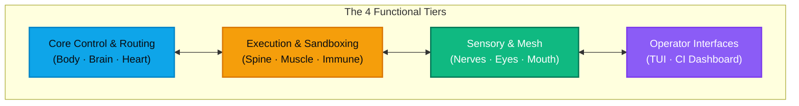

# Autonomic AI — Distributed Autonomous Agent Runtime

Welcome to the **Autonomic AI** Documentation Hub.

Autonomic AI is an open-source, bio-digital autonomous agent ecosystem engineered in **Rust** with hardware acceleration for Apple Silicon and Linux GPU clusters. Modeled after biological homeostasis, **eleven specialized autonomous organs** operate as decoupled microservices communicating over Unix Domain Sockets and high-throughput **NATS JetStream** messaging.



---

## The Monolithic Agent Problem

Traditional AI coding frameworks (LangChain, AutoGen, CrewAI, monolithic agent prompts) collapse under complex, long-running software engineering tasks:
1. **Context Window Thrashing**: Loading entire tool catalogs, codebase rules, and conversation histories simultaneously exhausts LLM context windows and induces hallucinations.
2. **Cascading Failure**: A crash in a single command execution tool or an out-of-memory bug terminates the entire agent session, wiping away in-flight state.
3. **Improvised Control Flow**: Ad-hoc probabilistic `while` loops lack determinism, time-travel debugging, and auditability.
4. **Unbounded Financial Quota Burn**: An agent caught in an infinite retry loop can run up thousands of dollars in cloud API bills overnight.

---

## The Autonomic Solution: Structure Beats Intelligence

Autonomic treats agent engineering as a **distributed systems problem**. It isolates responsibilities across eleven purpose-built organs:

| Organ | Tier | Core Specialization | Interface |
| :--- | :--- | :--- | :--- |
| **`agent-body`** | **Core** | Control plane supervisor, launchd manager, catalog discovery | UDS / CLI (`autonomic`) |
| **`agent-brain`** | **Core** | Temporal SQLite memory, HNSW vector search, recipe routing | Stdio / MCP (`route_task`) |
| **`agent-heart`** | **Core** | Daily token budget ceilings, anomaly detection, nightly GC | HTTP `:3101` / MCP |
| **`agent-spine`** | **Execution** | Deterministic YAML DAG engine, immutable snapshot store | HTTP `:3100` / CLI |
| **`agent-muscle`** | **Execution** | Tree-sitter AST safety guard, 4KB slicer, K8s GPU runner | HTTP `:3103` / MCP |
| **`agent-immune`** | **Execution** | OSV CVE vulnerability scan, seccomp/Firecracker microVM | HTTP `:3106` / MCP |
| **`agent-mouth`** | **Sensory** | Ingress API gateway, Slack approval gates, SSE streams | HTTP `:3104` / MCP |
| **`agent-nerves`** | **Sensory** | NATS JetStream event bus, stream bootstrap, WASM filters | NATS `:4222` / `:3102` |
| **`agent-eyes`** | **Sensory** | Spatial DOM index in SQLite, SSIM diffs, local LLaVA VLM | HTTP `:3105` / MCP |
| **`agent-tui`** | **Interface** | Terminal avionics HUD, live DAG visualizer in Ratatui | TTY Console (`agent-tui`) |
| **`agent-ci-dashboard`**| **Interface** | Mission control web telemetry, PR checks, batch merges | SvelteKit 5 Web App |

---

## Quickstart

Install the ecosystem via Homebrew and start the cluster:

```bash
# 1. Install via Homebrew
brew tap autonomic-ai-dev/tap
brew install autonomic-stack

# 2. Initialize ~/.autonomic workspace
autonomic init

# 3. Boot the organ cluster
autonomic start

# 4. Launch the terminal HUD
agent-tui
```
