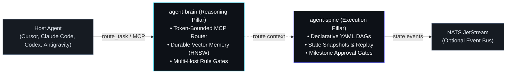

<div id="hero" class="space-y-4 not-prose mb-8">
  <div class="inline-flex items-center gap-2 px-3 py-1 rounded-full bg-cyan-950/70 border border-cyan-500/30 text-xs font-mono text-cyan-300">
    <span class="w-2 h-2 rounded-full bg-cyan-400 animate-pulse"></span>
    <span>Autonomic 1.0.0-rc2 — Strict Dual-Engine Specification</span>
  </div>

  <h1 class="text-3xl sm:text-4xl lg:text-5xl font-headline font-extrabold tracking-tight text-white leading-[1.15]">
    Autonomic AI Documentation — <br/>
    <span class="bg-clip-text text-transparent bg-gradient-to-r from-cyan-400 via-indigo-300 to-indigo-500">
      Dual-Engine Architecture
    </span>
  </h1>

  <p class="text-base sm:text-lg text-slate-300 font-body leading-relaxed max-w-3xl">
    Autonomic AI strictly bifurcates stochastic machine cognition from deterministic operational execution. 
    By decoupling reasoning into <code class="font-mono text-cyan-400 bg-cyan-950/60 px-1.5 py-0.5 rounded border border-cyan-500/25">agent-brain</code> and resilient workflow orchestration into <code class="font-mono text-indigo-400 bg-indigo-950/60 px-1.5 py-0.5 rounded border border-indigo-500/25">agent-spine</code>, systems avoid cascading token hallucinations, eliminate execution drift, and guarantee mathematical verification across autonomous agent deployments.
  </p>
</div>

---

<section id="dual-engine-blueprint" class="my-10">

## Dual-Engine Architectural Blueprint



</section>

---

### The Two Pillars

| Subsystem | Architectural Role | Storage & Substrate | Primary Interfaces |
| :--- | :--- | :--- | :--- |
| **`agent-brain`** | Cognitive Router, token-bounded context defence, and vector memory | Embedded SQLite with FTS5, in-process HNSW 4096-dim vector index | MCP (`route_task`, `store_memory`, `skill_get`), CLI (`serve`, `doctor`, `install`) |
| **`agent-spine`** | Deterministic DAG runner, milestone approval gates, and state replay | SQLite state database (`~/.autonomic/logs/spine/state.db`) | CLI (`run`, `validate`, `init`, `inspect`, `replay`), MCP bridge, NATS events |

---

<section id="quickstart" class="my-10">

## Quickstart & Installation

Autonomic AI distributes pre-compiled universal binaries for **macOS Apple Silicon (ARM64)** via Homebrew:

```bash
# 1. Tap the official formula repository
brew tap autonomic-ai-dev/tap

# 2. Install agent-brain and agent-spine binaries
brew install agent-brain agent-spine

# 3. Mount MCP hooks across your installed editors
agent-brain install --global

# 4. Verify system diagnostics and codesign integrity
agent-brain doctor

# 5. Initialize agent-spine workflow state
agent-spine init
```

See [Quick Installation](/docs/installation) for details on building from source via Cargo on other platforms.

</section>

---

<section id="invariants" class="my-10">

## Invariant & Safety Contracts

Autonomic AI enforces four strict runtime invariants:

1. **One Brain Daemon Behind Many Editors**:
   Several editors can run agent-brain simultaneously. `agent-brain serve` acts as an stdio proxy to a single background daemon owning SQLite and HNSW indexes, ensuring concurrent turns never fight over file locks.

2. **Route Before Action**:
   Host hooks block agent-brain tools until the agent issues `route_task`. This guarantees every prompt receives a ranked, token-budgeted slice of skills and memories without token pollution.

3. **Deterministic State Replay**:
   Every step in an `agent-spine` workflow generates an immutable SQLite state checkpoint. If a task fails or requires auditing, `agent-spine replay <run-id>` recreates the exact state machine transition.

4. **Strict Boundary Isolation**:
   Tools are executed in isolated harnesses with `.verify/` tamper-proof outcome logs. No unverified mutations or comment slop are permitted.

</section>

---

## Where to Go Next

- [Dual-Engine Architecture](/docs/architecture) — Comprehensive topology, memory schemas, and execution guarantees.
- [agent-brain Manual](/docs/memory) — HNSW vector indexing, turn gating, and skill packages.
- [agent-spine Manual](/docs/workflows) — Declarative YAML DAG definitions and approval gates.
- [CLI Reference Manual](/docs/cli) — Complete CLI syntax, flags, and exit codes for both binaries.
- [Workflows Hub](/workflows) — Interactive library of pre-built DAG workflows and curated skill packages.
