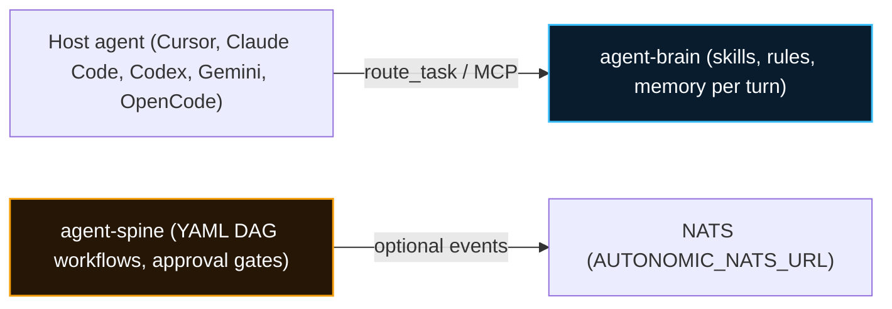

# Autonomic AI: Right Skill, Right Memory, Right Time

Autonomic AI is two components, both written in **Rust** and both local-first:

- **agent-brain** decides which skills, rules, and memories an AI coding agent sees on each turn, within a token budget.
- **agent-spine** runs deterministic YAML workflows with explicit state and approval gates, so the LLM works inside steps you define.



---

## The problem

Coding agents slow down and cost more as their context grows. Loading every skill, rule, and past conversation into each prompt causes drift, hallucinated steps, and large token bills. Ad-hoc retry loops have no bound on cost or behaviour.

## The approach

- **Route before acting.** agent-brain returns a ranked, budgeted set of context for each turn. Host hooks block brain tools until the agent has routed the turn.
- **Deterministic workflows.** agent-spine's workflows define the steps and the gates. The LLM does the work inside each step.
- **Local first.** Databases, indexes, and logs live under `~/.autonomic/`. Nothing leaves your machine unless you configure NATS or a remote model API.

## What the numbers show

- Warm-cache route p95 is 24 ms on a synthetic 1,000-item index.
- Recall@3 on the 20-case CI eval is 0.95.
- Route latency has a long tail in real use. This is under investigation.

---

## Quickstart

```bash
brew tap autonomic-ai-dev/tap
brew install agent-brain agent-spine

agent-brain install --global
agent-brain doctor
agent-spine init
```

See [Installation & Deployment](/docs/installation) for details, including NATS settings and building from source.

---

## Where to go next

- [Architecture](/docs/architecture): how the two components fit together.
- [agent-brain](/docs/memory): the memory and routing component.
- [agent-spine](/docs/workflows): the workflow component.
- [CLI reference](/docs/cli): commands for both components.
- [MCP](/docs/mcp): the tools agent-brain exposes to hosts.
