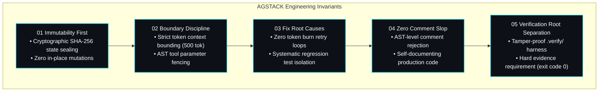

<div id="hero" class="space-y-4 not-prose mb-8">
  <div class="inline-flex items-center gap-2 px-3 py-1 rounded-full bg-cyan-950/70 border border-cyan-500/30 text-xs font-mono text-cyan-300">
    <span class="w-2 h-2 rounded-full bg-cyan-400 animate-pulse"></span>
    <span>Autonomous SDLC Specification — AGSTACK Invariants</span>
  </div>

  <h1 class="text-3xl sm:text-4xl lg:text-5xl font-headline font-extrabold tracking-tight text-white leading-[1.15]">
    AGSTACK SDLC — <br/>
    <span class="bg-clip-text text-transparent bg-gradient-to-r from-cyan-400 via-indigo-300 to-indigo-500">
      Deterministic Engineering Invariants
    </span>
  </h1>

  <p class="text-base sm:text-lg text-slate-300 font-body leading-relaxed max-w-3xl">
    AGSTACK is the foundational engineering standard powering Autonomic AI. It replaces statistical prompt hope with deterministic mathematical and runtime constraints. By enforcing strict boundaries, immutable state transitions, and automated verification harnesses, AGSTACK ensures agentic code generation achieves production-grade rigor.
  </p>
</div>

---

<section id="engineering-invariants" class="my-10">

## The Five Mandatory Engineering Invariants

Modern LLMs degrade when given unbounded context or conversational feedback loops. AGSTACK establishes five non-negotiable runtime pillars enforced across both `agent-brain` and `agent-spine`:



### 1. Immutability First
Once an agent or organ step validates, artifacts are cryptographically hashed and sealed. No background modifications or hidden side effects are allowed. State mutations must return fresh copies rather than modifying shared runtime references in-place.

### 2. Boundary Discipline
Context windows are hard-capped (defaulting to 500 token contextual bundles in `agent-brain route_task`). AST tool parameters are strictly validated at invocation boundaries. Agents cannot exceed assigned scopes or hallucinate out-of-band parameters.

### 3. Fix Root Causes & Model Usage Governance
When an execution fails, trace analysis pinpoints the underlying architectural defect rather than burning operational tokens on repetitive speculative prompts. Defensive null-checks that mask underlying bugs are rejected; fixes must be verified with regression test coverage.

### Model Usage & Budget Governance
AGSTACK enforces hard ceilings on LLM token usage and execution budgets. Rather than passing entire file trees or infinite conversational trajectories, `agent-brain route_task` limits context bundles to a strict budget (default 500 tokens). Real-time telemetry tracking (`agent-brain stats`) records per-turn token consumption and halts execution when budgets are exceeded, eliminating runaway token loops.

### 4. Zero Comment Slop
Codebases must remain clean and maintainable. AGSTACK strictly rejects AI narrative padding, conversational comments, and redundant docstring chatter. Code must be self-documenting, and pre-commit checks automatically reject unnecessary comment lines.

### 5. Verification Root Separation
All generated test harnesses, snapshots, logs, and artifacts MUST output strictly to `.verify/` (keeping input reference fixtures under `verify/` read-only). A code change is considered incomplete until verified via `agent-brain verify -- <cmd>` and recorded with an exit code of `0`.

</section>

---

<section id="lifecycle-matrix" class="my-10">

## AGSTACK SDLC Lifecycle Matrix

AGSTACK structures software delivery into six deterministic phases. Each phase transitions only when automated exit criteria are satisfied:

| Phase | Objective | Verification Gate | Primary Tool / Engine |
| :--- | :--- | :--- | :--- |
| **01. Intent & Context** | Ground intent in repository domain model and AST symbols. | Token budget &le; 500 tokens; schema match. | `agent-brain route_task` |
| **02. Contract Specification** | Draft four-part contract (Domain, Types, Errors, Invariants). | Schema validation & static type check. | `agent-spine init` |
| **03. Minimal Implementation** | Apply changes respecting immutability and zero comment slop. | AST linter passes without narrative comments. | Native Tooling / LSP |
| **04. Verification Harness** | Execute isolated test suite within `.verify/`. | Command exits 0 recorded in `.verify/artifacts/`. | `agent-brain verify` |
| **05. Security Audit** | Check boundary isolation and credential access gates. | Automated AST permission check passes. | `agent-spine validate` |
| **06. Review & Seal** | Human approval gate followed by cryptographic snapshot seal. | Founder / Lead signoff on DAG gate. | `agent-spine status` |

</section>

---

<section id="verification-harness" class="my-10">

## The `.verify/` Deterministic Harness

The hallmark of AGSTACK is mathematical verification over conversational claims. No task is marked complete based on an agent's assertion:

```bash
# 1. Verification config (.verify/verify.toml) defines approved commands
cat <<EOF > .verify/verify.toml
allowlist = [
  "bash .verify/run.sh",
  "bun test",
  "cargo test --workspace",
  "cargo clippy -- -D warnings"
]
EOF

# 2. Run your verification suite through agent-brain
agent-brain verify -- bash .verify/run.sh
```

When executed, `agent-brain verify` produces an immutable JSON outcome record:

```json
{
  "id": "d28b0549-cc00-41d6-abc9-914f8656a7ac",
  "exit_code": 0,
  "success": true,
  "scenario_dir_hash": "c75187189bda2ee828b5af821dcb4ca55055314b868597b85f2634344bff1103",
  "cmd": "bash .verify/run.sh",
  "source": "cli",
  "verify_root": "/project"
}
```

</section>

---

<section id="cli-integration" class="my-10">

## Bootstrapping AGSTACK in Your Project

To integrate AGSTACK into any codebase:

### 1. Install the AGSTACK Skill Bundle
Using `agent-brain`, fetch the audited AGSTACK skill package into local vector memory:

```bash
agent-brain package add @agstack
```

### 2. Scaffold a Spine DAG Workflow
Initialize an automated lifecycle DAG from the curated registry:

```bash
# For feature development with review gates
agent-spine init --with @feature

# For systematic bug reproduction and regression testing
agent-spine init --with @bugfix

# For startup MVP and customer validation
agent-spine init --with @minimalist-entrepreneur
```

### 3. Execute with Zero Execution Drift
Execute the workflow state machine:

```bash
agent-spine run --workflow feature.yaml
```

</section>

---

<section id="related-resources" class="my-10">

## Related Resources

* [Dual-Engine Architecture](/docs/architecture) — Memory model and bifurcated execution.
* [Workflows & Packages Registry](/registry) — Browse curated DAGs and skill packages.
* [agent-brain CLI Reference](/docs/cli/agent-brain) — Cognitive router commands and routing options.
* [agent-spine CLI Reference](/docs/cli/agent-spine) — DAG validation and execution commands.

</section>
