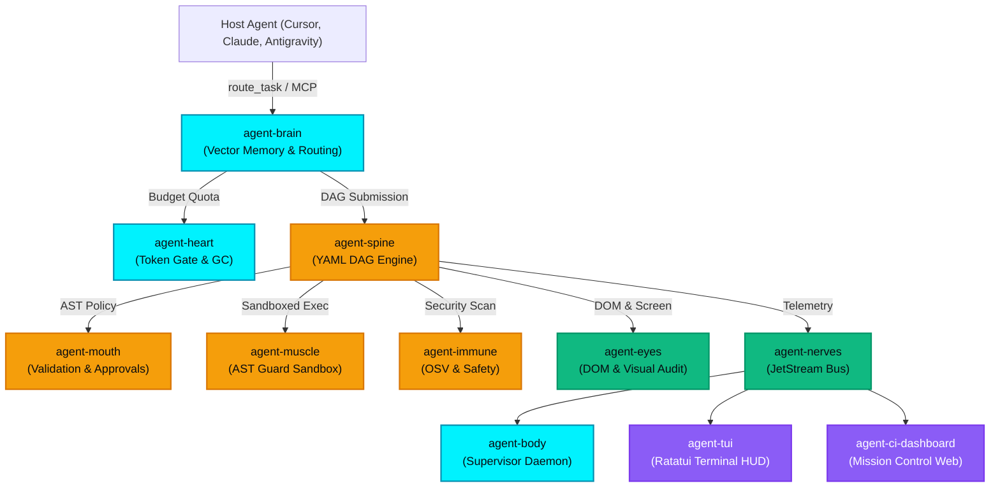

# Autonomic AI Architecture & Subsystem Specification

The Autonomic AI Ecosystem is a decentralized, bio-digital autonomous agent runtime engineered in **Rust** and **Darwin ARM64 Metal acceleration**. Modeled after biological homeostasis, eleven specialized autonomous "organs" operate as independent, sandboxed processes communicating over Unix Domain Sockets and high-throughput NATS JetStream messaging.

---

## The 11 Organs & 4 Functional Tiers

| Organ | Tier | Primary Responsibility | Interface & Protocol |
| :--- | :--- | :--- | :--- |
| **`agent-body`** | **Core** | Supervisor daemon, launchd manager, catalog discovery | Unix Domain Socket / CLI daemon |
| **`agent-brain`** | **Core** | Temporal SQLite memory, HNSW vector search, recipe routing | MCP (`route_task`, `store_memory`) |
| **`agent-heart`** | **Core** | Token budget enforcement, memory GC, CRON scheduler | MCP (`heart_budget_status`, `heart_gc`) |
| **`agent-spine`** | **Execution** | Deterministic YAML DAG workflow engine & snapshots | MCP (`spine_submit_workflow`), CLI |
| **`agent-muscle`** | **Execution** | Tree-sitter AST safety guard, sandboxed runner, 4KB slicer | MCP (`muscle_execute_bash`, `muscle_execute_python`) |
| **`agent-immune`** | **Execution** | OSV CVE vulnerability scan, memory growth checks | MCP (`immune_scan_manifest`, `immune_sandbox_run`) |
| **`agent-mouth`** | **Execution** | AST command validation, Slack/Discord approval gates | MCP (`mouth_validate_ast`, `mouth_request_approval`) |
| **`agent-nerves`** | **Sensory** | NATS JetStream event bridge & durable streaming | `nats:organs.*` high-speed bus |
| **`agent-eyes`** | **Sensory** | Playwright screen capture, DOM indexing, local VLM | MCP (`eyes_describe_dom`, `eyes_diff_screenshots`) |
| **`agent-tui`** | **Interface** | Terminal HUD, live DAG visualizer, vitals stream | Ratatui TTY console |
| **`agent-ci-dashboard`** | **Interface** | Mission control web telemetry, PR checks, batch merges | SvelteKit 5 + Tailwind Web App |

---

## Core Architectural Invariants

### 1. Proxy-over-Supervised-Daemon Architecture
To prevent `database is locked` concurrency errors across concurrent IDE turns (Cursor, OpenCode, Claude Code, Antigravity), `agent-brain serve` runs as a lightweight stdio proxy connecting to `~/.autonomic/memory/serve.sock`. A single background daemon manages SQLite WAL access and in-memory HNSW vector indexes with zero lock contention.

### 2. Turn Routing & Token Gating
Before any tool execution, `route_gate.py` intercepts the agent turn. The agent must first query `route_task`, which injects token-budgeted memory, applicable rules, and battle-tested **`verified_recipes`** (`exit 0`). Full-file reads on large repositories are intercepted and redirected to bounded scout tools (`file_summary`, `grep_search`, `read_file_head`).

### 3. Tree-sitter AST Sandboxing (`agent-muscle`)
Every shell invocation is pre-parsed into a concrete syntax tree via `ast_guard.rs` before being dispatched to the operating system. Malicious patterns (`rm -rf /`, piping remote URLs into `sh`, fork bombs) are terminated before execution. Output exceeding 4KB is dynamically sliced by `output_slicer.rs`, preserving the vital diagnostic head and tail traces.

### 4. Verification Playbooks (`.verify/`)
Every repository maintains an executable `.verify/run.sh` test playbook. Verification requires passing all unit/integration tests, zero compiler warnings (`-D warnings`), and automated recall benchmarks before release promotion.
