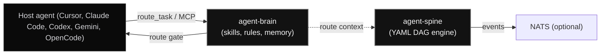

# Architecture

Autonomic AI has two components. Each is a local process with its own state, and neither depends on a shared library.

---

## The two components

| Component | Responsibility | Storage | Interface |
| :--- | :--- | :--- | :--- |
| **agent-brain** | Ranks skills, rules, and memory per turn within a token budget | SQLite with FTS5, in-process vector index | MCP (`route_task`, `store_memory`, `skill_search`, `skill_get`), CLI |
| **agent-spine** | Runs YAML workflow DAGs with explicit state and approval gates | Local state database and execution journal | CLI (`init`, `run`), MCP bridge, optional NATS events |

---

## Core invariants

### 1. One brain daemon behind many editors

Several editors can run agent-brain at once. `agent-brain serve` is a stdio proxy to a single daemon that owns the database, so concurrent turns do not fight over the lock.

### 2. Route before action

Before a turn's first tool call, the agent calls `route_task`. The response carries the budgeted context, the applicable rules, and any verified recipes. Host hooks enforce this order.

### 3. Local storage and explicit egress

agent-brain stores its data under `~/.autonomic/memory`. agent-spine stores its state under `~/.autonomic/state/spine`. Data leaves the machine only if you configure NATS (`AUTONOMIC_NATS_URL`) or a remote model API.

### 4. Verification playbooks

Each repository keeps an executable `.verify/` harness. A change counts as done when the allowlisted commands pass, including tests, clippy with warnings denied, and the eval gate for agent-brain.

---

## Scope

The earlier eleven-organ design (supervisor, sandbox, security scanner, event mesh, dashboards) is out of scope and is not documented here. The organ pages elsewhere on this site describe that earlier design.
