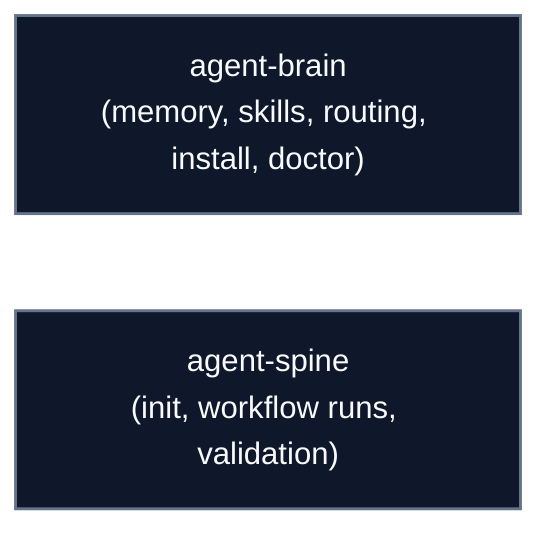

# CLI Reference

Autonomic AI ships two command-line binaries, both built in **Rust** with `clap`:

- **`agent-brain`**: skills, rules, memory, routing, and the editor hooks.
- **`agent-spine`**: YAML workflow runs and validation.

---

## Global options

| Flag | Short | Type | Description |
| :--- | :--- | :--- | :--- |
| `--help` | `-h` | Boolean | Prints concise usage instructions, subcommands, and flags. |
| `--version` | `-V` | Boolean | Prints the binary version. |

## Exit codes

| Exit Code | Meaning | Typical Scenario |
| :---: | :--- | :--- |
| `0` | **Success** | Command executed without errors. |
| `1` | **General Error** | Runtime failure, missing prerequisite, or unhandled exception. |
| `2` | **CLI Syntax Error** | Invalid flags, missing required arguments, or unknown subcommand. |
| `69` | **Service Unavailable** | Target daemon is offline or refused connection. |
| `78` | **Configuration Error** | Malformed TOML/YAML configuration or schema validation failure. |

---

## CLI reference index

| Binary | Role | Dedicated Reference |
| :--- | :--- | :--- |
| **`agent-brain`** | Memory, skill packages, routing, editor install, health checks | [`/docs/cli/agent-brain`](/docs/cli/agent-brain) |
| **`agent-spine`** | Deterministic YAML DAG workflow execution and validation | [`/docs/cli/agent-spine`](/docs/cli/agent-spine) |

Pages for other binaries from the earlier eleven-organ design have been removed from the navigation. They are out of scope.
