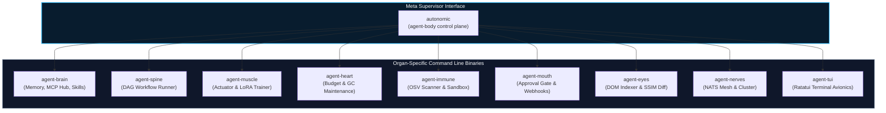

# Autonomic CLI Reference

Welcome to the **Autonomic Command Line Interface (CLI) Reference**.

The Autonomic ecosystem provides a unified meta-orchestrator (`autonomic`) alongside dedicated standalone CLI binaries for each autonomous organ. Every CLI is built in **Rust** with `clap` v4, supporting structured flag parsing, POSIX-compliant exit codes, standardized `--help` output, and unified logging.

---

## Ecosystem CLI Architecture

---

## Universal Conventions

Across all Autonomic binaries, the following conventions apply:

### Global Options

| Flag | Short | Type | Description |
| :--- | :--- | :--- | :--- |
| `--help` | `-h` | Boolean | Prints concise usage instructions, subcommands, and flags. |
| `--version` | `-V` | Boolean | Prints the binary semantic version and git commit SHA. |
| `--progress` | — | String | Progress output style: `auto` (default), `plain` (CI), or `quiet`. |

### Standard Exit Codes

| Exit Code | Meaning | Typical Scenario |
| :---: | :--- | :--- |
| `0` | **Success** | Command executed without errors. |
| `1` | **General Error** | Runtime failure, missing prerequisite, or unhandled exception. |
| `2` | **CLI Syntax Error** | Invalid flags, missing required arguments, or unknown subcommand. |
| `69` | **Service Unavailable** | Target daemon is offline or refused connection. |
| `78` | **Configuration Error** | Malformed TOML/YAML configuration or schema validation failure. |

---

## CLI Reference Index

Explore the flag-level documentation for each command line utility:

| Binary | Organ | Role | Dedicated Reference |
| :--- | :--- | :--- | :--- |
| **`autonomic`** | `agent-body` | Cluster supervision, daemon lifecycle, launchd service management | [`/docs/cli/autonomic`](/docs/cli/autonomic) |
| **`agent-brain`** | `agent-brain` | Temporal vector memory, HNSW reasoning, MCP server hub, skill packages | [`/docs/cli/agent-brain`](/docs/cli/agent-brain) |
| **`agent-spine`** | `agent-spine` | Deterministic YAML DAG workflow execution, step replays, validation | [`/docs/cli/agent-spine`](/docs/cli/agent-spine) |
| **`agent-muscle`** | `agent-muscle` | Sandboxed script execution, Tree-sitter AST validation, LoRA fine-tuning | [`/docs/cli/agent-muscle`](/docs/cli/agent-muscle) |
| **`agent-heart`** | `agent-heart` | Token budget enforcement, cluster memory distillation, automated GC | [`/docs/cli/agent-heart`](/docs/cli/agent-heart) |
| **`agent-immune`** | `agent-immune` | OSV vulnerability auditing, network-isolated sandboxing, RSS leak detection | [`/docs/cli/agent-immune`](/docs/cli/agent-immune) |
| **`agent-mouth`** | `agent-mouth` | Ingress webhook listener, human approval gates, bash AST validation | [`/docs/cli/agent-mouth`](/docs/cli/agent-mouth) |
| **`agent-eyes`** | `agent-eyes` | Headless Chrome screenshot capture, SSIM pixel diff, spatial DOM indexing | [`/docs/cli/agent-eyes`](/docs/cli/agent-eyes) |
| **`agent-nerves`** | `agent-nerves` | NATS JetStream event mesh, multi-node clustering, traffic inspection | [`/docs/cli/agent-nerves`](/docs/cli/agent-nerves) |
| **`agent-tui`** | `agent-tui` | High-frequency terminal avionics HUD, live workflow visualizer, organ matrix | [`/docs/cli/agent-tui`](/docs/cli/agent-tui) |
