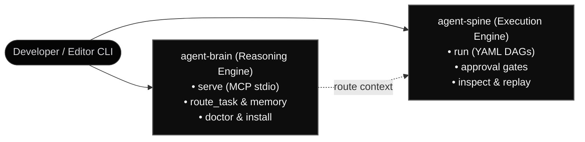

<div id="hero" class="space-y-4 not-prose mb-8">
  <div class="inline-flex items-center gap-2 px-3 py-1 rounded-full bg-white/[0.04] border border-white/10 text-xs font-mono text-neutral-300">
    <span class="w-1.5 h-1.5 rounded-full bg-white"></span>
    <span>autonomic-ai.dev/cli — Official Manual</span>
  </div>

  <h1 class="text-3xl sm:text-4xl lg:text-5xl font-headline font-extrabold tracking-tight text-white leading-[1.15]">
    Autonomic AI CLI Reference
  </h1>

  <p class="text-base sm:text-lg text-neutral-300 font-body leading-relaxed max-w-3xl">
    Command-line interface manual for the Autonomic AI dual-engine architecture. Manage token-bounded cognitive governor routing, procedure graph recall, and vector memory with <code class="font-mono text-white bg-white/[0.06] px-1.5 py-0.5 rounded border border-white/10">agent-brain</code>, and orchestrate deterministic YAML DAG state machines with <code class="font-mono text-white bg-white/[0.06] px-1.5 py-0.5 rounded border border-white/10">agent-spine</code>.
  </p>
</div>

---

<section id="quickstart" class="my-8">

## Quickstart Installation

Autonomic AI provides pre-compiled universal binaries for **macOS Apple Silicon (ARM64)** via Homebrew, or via Cargo from source:

```bash
# Recommended on macOS Apple Silicon (ARM64)
brew tap autonomic-ai-dev/tap
brew install agent-brain agent-spine

# Configure editor hooks and verify daemon health
agent-brain install --global
agent-brain doctor
agent-spine init
```

</section>

---

## The Dual Engines



---

<section id="engine-index" class="my-8">

## Core Command Index

### 1. `agent-brain` (Reasoning Engine)

Dedicated reference: [`/docs/cli/agent-brain`](/docs/cli/agent-brain)

| Command | Role | Description |
| :--- | :--- | :--- |
| **`serve`** | Daemon mode | Start the MCP server over standard input/output (`stdio`). |
| **`route_task`** | Turn gating | Rank skills, rules, and vector memory for a prompt within token limits. |
| **`install`** | Editor setup | Mount MCP and turn-routing hooks across Cursor, VS Code, Claude Code, Antigravity. |
| **`doctor`** | Diagnostics | Check daemon reachability, SQLite graph, HNSW vector count, and codesign. |
| **`package add`** | Skill packages | Install curated packages from registry aliases (e.g., `@agstack`, `@matt-skills`). |
| **`stats`** | Telemetry | Inspect local route latency (p95, p99), cache hit rates, and token headroom. |

---

### 2. `agent-spine` (Execution Engine)

Dedicated reference: [`/docs/cli/agent-spine`](/docs/cli/agent-spine)

| Command | Role | Description |
| :--- | :--- | :--- |
| **`run <workflow>`** | Execute DAG | Execute declarative YAML DAG workflow with state snapshots. |
| **`validate <workflow>`**| Invariant check | Parse and validate YAML DAG syntax, budget limits, and Kahn cycle detection. |
| **`init`** | Workflow scaffold | Initialize state directory and generate built-in templates (`--with list`). |
| **`status`** | Audit | Display execution journal status and sealed audit records. |
| **`inspect <run-id>`** | Forensics | Inspect step outputs, transition history, and errors for a run. |
| **`replay <run-id>`** | Parity replay | Replay a previous run to verify state machine transitions. |

</section>

---

<section id="global-options" class="my-8">

## Global Options

All Autonomic binaries adhere to POSIX / GNU command conventions built on Rust's `clap`:

| Flag | Short | Type | Description |
| :--- | :--- | :--- | :--- |
| `--help` | `-h` | Boolean | Print command syntax, options, and subcommand descriptions. |
| `--version` | `-V` | Boolean | Print installed binary version (`1.0.0-rc2`). |

---

## Exit Codes

Deterministic exit codes allow spine workflows and CI pipelines to safely evaluate command outcomes:

| Exit Code | Meaning | Typical Scenario |
| :---: | :--- | :--- |
| `0` | **Success** | Command completed cleanly with verified state. |
| `1` | **General Error** | Runtime exception, missing prerequisite, or uncaught failure. |
| `2` | **Syntax Error** | Malformed CLI arguments, unknown subcommand, or invalid flag. |
| `69` | **Unavailable** | Target daemon is offline, refused socket, or failed handshake. |
| `78` | **Config Error** | Malformed YAML schema or precondition contract failure. |

</section>
