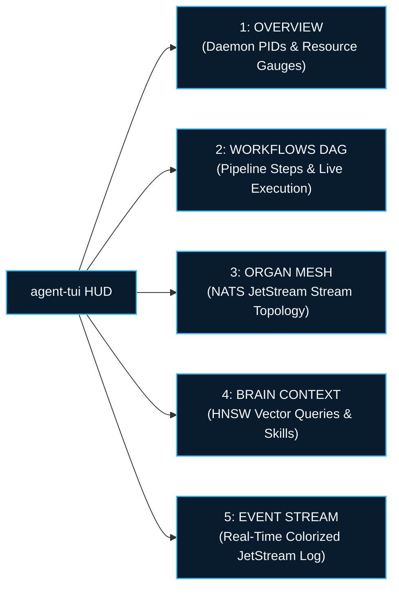

> **Out of scope.** This page describes a component from the earlier eleven-organ design. Autonomic AI currently consists of agent-brain and agent-spine only. See [Architecture](/docs/architecture).

# `agent-tui` CLI Reference

`agent-tui` is the terminal avionics console and live telemetry dashboard for the Autonomic AI ecosystem. Built in Rust with **Ratatui** and **Crossterm**, it provides low-latency monitoring of cluster health, DAG workflow progression, vector memory queries, and real-time NATS event streams directly in your shell.

---

## Synopsis

```bash
agent-tui [OPTIONS]
```

---

## Global Options

| Flag | Short | Type | Description |
| :--- | :--- | :--- | :--- |
| `--help` | `-h` | Boolean | Print command help and exit. |
| `--version` | `-V` | Boolean | Print version information. |

---

## Environment Variables

| Variable | Default Value | Description |
| :--- | :--- | :--- |
| `AUTONOMIC_NATS_URL` | `nats://127.0.0.1:4222` | URL of the NATS JetStream broker for live event streaming. |
| `AUTONOMIC_STATE_DIR` | `~/.autonomic/state` | Path to state directory containing `spine/state.db`. |

---

## Interactive Dashboard Tabs



### 1. `OVERVIEW`
Displays the homeostasis matrix of all 11 organs:
- Process status (`RUNNING`, `STARTING`, `CRASHED`).
- System PIDs and uptime counters.
- Aggregated CPU percentage and Resident Set Size (RSS) memory gauges.

### 2. `WORKFLOWS DAG`
Live step execution monitor for `agent-spine`:
- Displays DAG execution hierarchy and step dependencies.
- Colorized step status (`PENDING`, `RUNNING`, `SUCCESS`, `FAILED`).
- Step elapsed execution timers and error diagnostics.

### 3. `ORGAN MESH`
Network topology view:
- NATS JetStream connection status and consumer lag.
- Inter-organ message transmission rates (msg/sec).
- HTTP healthcheck probe latency across ports `:3100` through `:3106`.

### 4. `BRAIN CONTEXT`
Knowledge graph telemetry:
- Displays recently matched vector embeddings and similarity scores.
- Active skill packages loaded into the prompt router.
- Staged skill promotion approval queues.

### 5. `EVENT STREAM`
High-frequency colorized event tailer:
- Real-time display of events published to `AUTONOMIC_EVENTS`.
- Automatic scrolling with pause-on-navigate capability.

### 6. `USAGE & BUDGET`
Mission control token spend and budget governor:
- Real-time token counts: input, output, and cache read hits.
- Spend vs daily/monthly ceiling gauges with warning thresholds.
- Organ attribution breakdown matrix and model market share.

---

## Keybindings

| Key | Action |
| :---: | :--- |
| `1` | Switch to **Overview** tab |
| `2` | Switch to **Workflows DAG** tab |
| `3` | Switch to **Organ Mesh** tab |
| `4` | Switch to **Brain Context** tab |
| `5` | Switch to **Event Stream** tab |
| `6` / `u` | Switch to **Usage & Budget** tab |
| `Tab` / `→` | Cycle forward to next tab |
| `Shift+Tab` / `←` | Cycle backward to previous tab |
| `↑` / `↓` | Scroll selected items in workflow DAG or event log |
| `g` | Trigger immediate GC pulse to `agent-heart` |
| `r` | Force refresh cluster state and telemetry |
| `q` / `Esc` | Cleanly exit terminal HUD and restore terminal state |

---

## Examples

```bash
# Launch terminal avionics dashboard using local socket
agent-tui
```

```bash
# Connect to a remote cluster NATS broker
AUTONOMIC_NATS_URL="nats://192.168.1.100:4222" agent-tui
```

```bash
# Launch with custom state directory location
AUTONOMIC_STATE_DIR="/var/lib/autonomic/state" agent-tui
```

```bash
# Launch terminal avionics HUD in an isolated tmux pane
tmux split-window -h "agent-tui"
```

```bash
# Run in continuous log view with stdout redirect for CI recording
agent-tui --help
```

