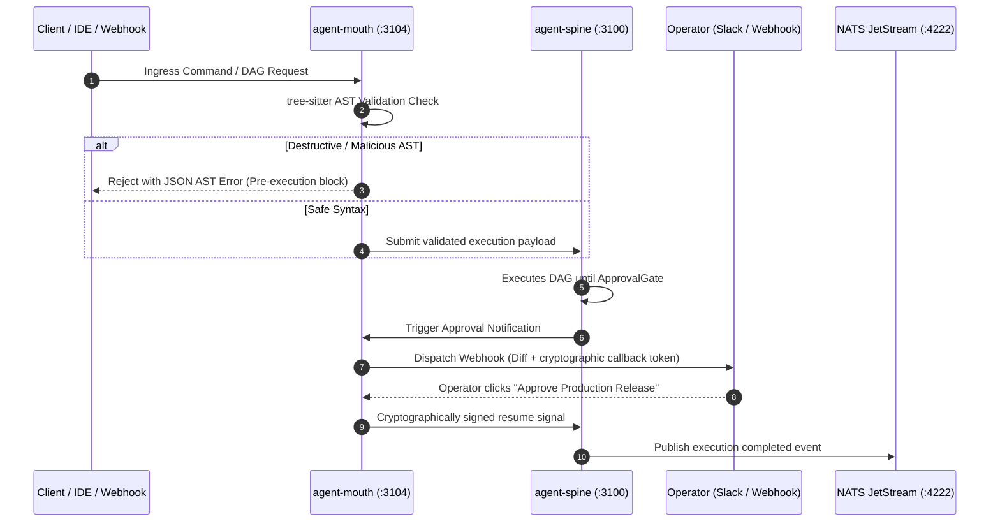

# `agent-mouth` — Ingress Gateway & AST Policy Validator

`agent-mouth` serves as the **Ingress API Gateway, AST Command Validator, and Human-in-the-Loop Notification Hub** for the Autonomic AI cluster. All external requests—whether originating from Cursor IDE, webhooks, or external REST clients—pass through `agent-mouth` before reaching internal daemons like `agent-spine` or `agent-muscle`.



---

## Architectural Invariants

### 1. Ingress Command AST Validation
Before an external request can schedule execution, `agent-mouth` parses the syntax using a `tree-sitter` bash and Python parser. It matches AST nodes against security rule manifests. Benign operations pass with zero delay; hazardous patterns (such as unquoted variable expansions in `eval`, pipe-to-shell patterns, and raw device access) are rejected at the parser level with structured diagnostics.

### 2. WebSocket & SSE Real-Time Streaming
`agent-mouth` bridges internal NATS JetStream events to standard HTTP Server-Sent Events (SSE) and WebSockets. This allows web applications (like `agent-ci-dashboard`) to receive millisecond-level telemetry streams without needing a direct TCP socket to the internal NATS broker.

### 3. Human Approval Gates (Webhooks)
When a workflow pauses on an `ApprovalGate` (e.g., prior to deploying a Homebrew bottle or publishing a crate), `agent-mouth` formats a rich notification card containing git diffs, test summaries, and one-click cryptographic callback actions. It holds the workflow until an authorized operator verifies the release.

### 4. Token-Budgeted Log Summarization
Large build outputs and error traces are piped through `agent-mouth summarize`. It applies deterministic deduplication, strips redundant ANSI escape codes, and produces an executive failure summary strictly bounded within a fixed token budget.

---

## Configuration Reference (`~/.autonomic/config.toml`)

```toml
[mouth]
port = 3104
slack_webhook_url = "https://hooks.slack.com/services/..."
discord_webhook_url = "https://discord.com/api/webhooks/..."
require_cryptographic_signatures = true
max_summary_tokens = 500
allowed_ingress_origins = ["https://agent-ci-dashboard.vercel.app", "http://localhost:5173"]
```

---

## CLI Command Reference

| Command | Flags | Description |
| :--- | :--- | :--- |
| **`agent-mouth validate`** | `--command "<cmd>"` | Tests a shell command string against the AST security policy. |
| **`agent-mouth summarize`** | `--max-tokens <N>` | Reads raw stdout from stdin and emits a concise diagnostic summary. |
| **`agent-mouth notify`** | `--channel <name>`, `--msg "..."` | Sends an immediate formatted alert card to configured webhooks. |
| **`agent-mouth serve`** | `--port 3104` | Boots the ingress gateway, SSE bridge, and webhook listener. |

### Example CLI Workflows

```bash
# 1. Validate a command before execution
agent-mouth validate --command "cargo test --release"
# Output: {"status": "ALLOWED", "risk_score": 0, "ast_nodes": 12}

# 2. Test piped log summarization
echo "2026-10-17 09:30:00 [ERROR] Connection timed out on port 3100\nat core/src/network.rs:42" | agent-mouth summarize
```

---

## MCP Tool Reference

- **`mouth_validate_ast`**: Evaluates proposed command syntax and returns safety classification and risk score.
- **`mouth_request_approval`**: Dispatches a human-in-the-loop approval request to external communication channels.
