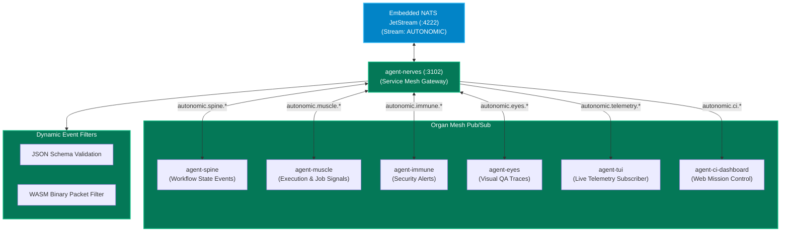

# `agent-nerves` — Distributed Event Mesh

`agent-nerves` is the **Service Mesh & Distributed Event Bus** (analogous to Istio / Linkerd) for the Autonomic ecosystem. It connects decoupled daemons to a shared **NATS JetStream** message broker, bootstraps the durable `AUTONOMIC` stream, and enforces dynamic WASM event filtering with automatic exponential backoff reconnection.



---

## Architectural Invariants

### 1. Asynchronous Decoupling via JetStream
Multi-agent systems composed solely of synchronous HTTP calls inevitably experience cascading deadlocks and timeout failures. Autonomic utilizes **NATS JetStream** to provide durable, at-least-once delivery with persistent message logs. When `agent-muscle` completes a 10-minute training or execution job, it publishes a completion packet to `autonomic.muscle.done`; `agent-spine` consumes the event whenever it is ready.

### 2. Stream Auto-Bootstrapping
Developers are freed from the operational burden of manually configuring NATS streams and retention policies. On boot, `agent-nerves`:
- Connects to the local or remote NATS broker.
- Asserts the existence of the `AUTONOMIC` stream.
- Configures default retention (`WorkQueue` or `Limits`), maximum message age (7 days), and memory storage tiers.
- Manages connection drops with jittered exponential backoff.

### 3. Dynamic WASM & JSON Event Filtering
To prevent noisy logs from saturating network interfaces, `agent-nerves` supports dynamic packet filtering:
- **JSON Rule Filters**: Drops malformed event packets before they reach subscriber queues.
- **WASM Extensibility**: Loads compiled WebAssembly modules (`~/.autonomic/filters/*.wasm`) to execute custom packet inspection and payload sanitization at wire speed.

---

## Subject Hierarchy Matrix

| Subject Pattern | Publisher | Consumers | Purpose |
| :--- | :--- | :--- | :--- |
| **`autonomic.spine.run.created`** | `agent-spine` | Dashboard, TUI | Broadcasts newly submitted workflow DAG. |
| **`autonomic.spine.gate.pause`** | `agent-spine` | `agent-mouth`, Dashboard | Notifies operators of pending HITL approval. |
| **`autonomic.muscle.train.request`**| `agent-brain` | `agent-muscle` | Dispatches GPU fine-tuning or LoRA training job. |
| **`autonomic.immune.cve.detected`** | `agent-immune` | `agent-spine`, Mouth | Emergency halt on vulnerability discovery. |
| **`autonomic.eyes.regression`** | `agent-eyes` | `agent-spine`, TUI | UI visual regression event with SSIM diff. |
| **`autonomic.telemetry.heartbeat`**| All Organs | `agent-body`, TUI | Real-time PID, memory RSS, and uptime beacon. |

---

## CLI Command Reference

| Command | Flags | Description |
| :--- | :--- | :--- |
| **`agent-nerves serve`** | `--port 3102`, `--features wasm` | Boots the service mesh bridge and JetStream monitor. |
| **`agent-nerves ping`** | `--timeout <s>` | Probes broker reachability and returns round-trip latency. |
| **`agent-nerves stream tail`** | `--subject <subj>`, `--follow` | Streams live events matching wildcard subject patterns. |
| **`agent-nerves cluster init`** | `--seed <host:port>` | Scaffolds a multi-node cluster configuration. |

### Example CLI Workflows

```bash
# 1. Probe the NATS mesh health
agent-nerves ping

# 2. Tail all security and execution events in real-time
agent-nerves stream tail --subject "autonomic.*" --follow
```
