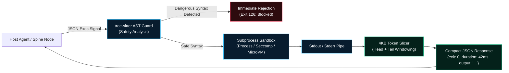

> **Out of scope.** This page describes a component from the earlier eleven-organ design. Autonomic AI currently consists of agent-brain and agent-spine only. See [Architecture](/docs/architecture).

# `agent-muscle` — Execution & Training Runtime

`agent-muscle` is the physical actuator and training runtime for the Autonomic AI cluster (`kubelet` / `CRI` analog). It decouples the LLM's high-level reasoning from low-level execution. Instead of forcing the model to generate sprawling Python wrappers and parse unbounded stdout streams character-by-character, `agent-muscle` executes commands natively with **tree-sitter AST safety guarding**, **4KB output slicing**, and **hardware-aware GPU orchestration**.



---

## Architectural Invariants

### 1. Pre-Execution Tree-Sitter AST Guard
Before any bash or Python script is spawned in a subshell, `agent-muscle` evaluates the abstract syntax tree using `tree-sitter`. It rejects catastrophic patterns before execution begins:
- Unbounded deletions (`rm -rf /`, `rm -rf ~`, `rm -rf /*`).
- Raw block device overwrites (`> /dev/sda`, `dd if=/dev/zero of=...`).
- Fork bombs and uncontrolled subshell fork loops.
- Obfuscated base64 payloads evaluated into active shells (`eval $(echo ... | base64 -d)`).

### 2. 4KB Output Slicer (Token Blowout Prevention)
A single noisy command (`npm test`, `cargo build --verbose`, `find /`) can produce megabytes of stdout. Dumping this into an LLM context window instantly causes rate limit failures and burns through context limits. `agent-muscle` intercepts stdout/stderr with a bounded **4KB Slicer**:
- Preserves the first 2KB (headers, command start, compilation flags).
- Inserts a compact truncation token (`[... 142 lines truncated ...]`).
- Preserves the trailing 2KB (actual error traces, stack lines, exit status).

### 3. Hardware-Aware Training Runtime
For model fine-tuning and LoRA preference optimization, `agent-muscle` dynamically queries local accelerator hardware:
- **macOS Apple Silicon**: Leverages Metal Performance Shaders (MPS) and MLX.
- **Linux GPU Nodes**: Uses CUDA Candle kernels and renders distributed Kubernetes `Job` manifests.

---

## CLI Command Reference

| Command | Flags | Description |
| :--- | :--- | :--- |
| **`agent-muscle run`** | `"<command>"`, `--cwd <dir>`, `--timeout <s>` | Runs a command through the AST safety guard and 4KB slicer. |
| **`agent-muscle status`** | `--json` | Displays actuator configuration, backends, and dataset paths. |
| **`agent-muscle k8s render-job`** | `--gpu <type>`, `--nodes <N>` | Emits an optimized Kubernetes GPU Job manifest. |
| **`agent-muscle serve`** | `--port 3103` | Starts the HTTP execution API and JetStream consumer. |

### Example CLI Workflows

```bash
# 1. Run a command safely with output slicing
agent-muscle run "cargo test --release" --timeout 120

# 2. Inspect active hardware accelerators (Metal / CUDA)
agent-muscle status

# 3. Test safety guard against a dangerous payload
agent-muscle run "rm -rf /"
# Output: [ERROR 126] Command rejected by AST safety policy: root deletion blocked.
```

---

## HTTP API & MCP Tools

`agent-muscle` exposes native tools for orchestrators:

- **`muscle_execute_bash`**: Executes a bash command with AST parsing and output slicing.
- **`muscle_execute_python`**: Runs Python code inside the sandboxed environment.
- **`POST /execute`**: Raw HTTP endpoint accepting JSON `{ "command": "...", "cwd": "..." }`.
- **`POST /train/run`**: Dispatches a training job across local or remote GPU queues.
