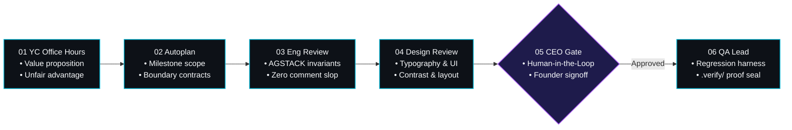

<div id="hero" class="space-y-4 not-prose mb-8">
  <div class="inline-flex items-center gap-2 px-3 py-1 rounded-full bg-cyan-950/70 border border-cyan-500/30 text-xs font-mono text-cyan-300">
    <span class="w-2 h-2 rounded-full bg-cyan-400 animate-pulse"></span>
    <span>Autonomous SDLC Specification — AGSTACK Framework</span>
  </div>

  <h1 class="text-3xl sm:text-4xl lg:text-5xl font-headline font-extrabold tracking-tight text-white leading-[1.15]">
    Garry Tan gstack <br/>
    <span class="bg-clip-text text-transparent bg-gradient-to-r from-yellow-400 via-amber-300 to-orange-400">
      Autonomous Review Engine
    </span>
  </h1>

  <p class="text-base sm:text-lg text-slate-300 font-body leading-relaxed max-w-3xl">
    Codifying high-velocity startup operating principles and YC review rigor into an immutable, multi-stage Directed Acyclic Graph (DAG) executed by <code class="text-cyan-400 font-mono">agent-spine</code>. Enforces relentless problem clarity, architectural invariants, design excellence, and human CEO signoff before any code touches production.
  </p>
</div>

---

<section id="gstack-dag" class="my-10">

## The gstack Review Pipeline

The gstack pipeline transitions code changes through multi-disciplinary review stages, terminating in an automated QA seal and immutable proof record:



</section>

---

<section id="review-stages" class="my-10">

## Review Stages & Evaluation Criteria

<div class="space-y-8">
  <div class="p-5 rounded-2xl bg-slate-900/40 border border-white/[0.08]">
    <div class="flex items-center justify-between mb-2">
      <h3 class="text-lg font-headline font-semibold text-white">01. YC Office Hours</h3>
      <span class="font-mono text-xs text-amber-400 bg-amber-950/60 px-2 py-0.5 rounded border border-amber-500/20">Agent Node</span>
    </div>
    <p class="text-sm text-slate-300 leading-relaxed">
      Clarifies the value proposition, target customer persona, and core 10x unfair advantage before any code is authored. Rejects unvalidated features or vague problem formulations before engineering tokens are spent.
    </p>
  </div>

  <div class="p-5 rounded-2xl bg-slate-900/40 border border-white/[0.08]">
    <div class="flex items-center justify-between mb-2">
      <h3 class="text-lg font-headline font-semibold text-white">02. Autoplan</h3>
      <span class="font-mono text-xs text-cyan-400 bg-cyan-950/60 px-2 py-0.5 rounded border border-cyan-500/20">Agent Node</span>
    </div>
    <p class="text-sm text-slate-300 leading-relaxed">
      Decomposes high-level requirements into bounded milestone deliverables. Establishes explicit API schemas, boundary conditions, and test definitions. Emits an immutable plan artifact into the workspace.
    </p>
  </div>

  <div class="p-5 rounded-2xl bg-slate-900/40 border border-white/[0.08]">
    <div class="flex items-center justify-between mb-2">
      <h3 class="text-lg font-headline font-semibold text-white">03. Engineering Review (AGSTACK)</h3>
      <span class="font-mono text-xs text-cyan-400 bg-cyan-950/60 px-2 py-0.5 rounded border border-cyan-500/20">Agent Node</span>
    </div>
    <p class="text-sm text-slate-300 leading-relaxed">
      Audits the pull request or codebase against the non-negotiable AGSTACK invariants: strict immutability, zero in-place mutations, bounded context queries, AST tool parameter verification, and absolute zero AI comment slop.
    </p>
  </div>

  <div class="p-5 rounded-2xl bg-slate-900/40 border border-white/[0.08]">
    <div class="flex items-center justify-between mb-2">
      <h3 class="text-lg font-headline font-semibold text-white">04. Design & Ergonomics Review</h3>
      <span class="font-mono text-xs text-cyan-400 bg-cyan-950/60 px-2 py-0.5 rounded border border-cyan-500/20">Agent Node</span>
    </div>
    <p class="text-sm text-slate-300 leading-relaxed">
      Evaluates user interface rendering, typography hierarchy, contrast ratios, and responsive breakpoints across mobile and desktop viewports. Validates that interactive states (hover, focus, active pills) respond predictably.
    </p>
  </div>

  <div class="p-5 rounded-2xl bg-purple-950/20 border border-purple-500/30">
    <div class="flex items-center justify-between mb-2">
      <h3 class="text-lg font-headline font-semibold text-white">05. CEO Approval Gate</h3>
      <span class="font-mono text-xs text-purple-400 bg-purple-950/60 px-2 py-0.5 rounded border border-purple-500/30">Approval Gate</span>
    </div>
    <p class="text-sm text-slate-300 leading-relaxed">
      Human founder or lead engineer signs off on functional architecture and customer experience before deployment. The engine blocks progression until approved via CLI or signed approval token.
    </p>
  </div>

  <div class="p-5 rounded-2xl bg-slate-900/40 border border-white/[0.08]">
    <div class="flex items-center justify-between mb-2">
      <h3 class="text-lg font-headline font-semibold text-white">06. QA Lead</h3>
      <span class="font-mono text-xs text-emerald-400 bg-emerald-950/60 px-2 py-0.5 rounded border border-emerald-500/20">Agent Node</span>
    </div>
    <p class="text-sm text-slate-300 leading-relaxed">
      Executes end-to-end regression suites and seals cryptographic verification receipts into <code class="text-emerald-400 font-mono">.verify/</code>. Verifies exit code 0 status before stamping the release build.
    </p>
  </div>
</div>

</section>

---

<section id="workflow-execution" class="my-10">

## Executing via agent-spine

Launch the gstack review engine directly from the Autonomic CLI:

```bash
# Execute the complete Garry Tan gstack review DAG
agent-spine run --workflow gstack

# Approve the CEO gate when prompted
agent-spine resume --run-id run_gstk_e8202b --node QALead

# Verify execution proof receipts
agent-spine status --run-id run_gstk_e8202b
```

</section>
