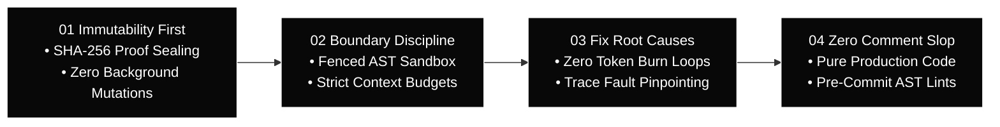

<div id="hero" class="space-y-4 not-prose mb-8">
  <div class="inline-flex items-center gap-2 px-3 py-1 rounded-full bg-white/[0.04] border border-white/10 text-xs font-mono text-neutral-300">
    <span class="w-1.5 h-1.5 rounded-full bg-white"></span>
    <span>Architectural Specification — Core Invariants</span>
  </div>

  <h1 class="text-3xl sm:text-4xl lg:text-5xl font-headline font-extrabold tracking-tight text-white leading-[1.15]">
    The Engineering Invariants That Never Fail
  </h1>

  <p class="text-base sm:text-lg text-neutral-300 font-body leading-relaxed max-w-3xl">
    Our core architectural pillars replace statistical hope with deterministic mathematical and runtime constraints. By stripping away stochastic drift, autonomous software engineering becomes reproducible, verifiable, and safe for production codebases.
  </p>
</div>

---

<section id="invariants-overview" class="my-10">

## Architectural Invariants Pipeline



</section>

---

<section id="immutability-first" class="my-10">

## 01. Immutability First

<div class="not-prose my-4 p-4 rounded-xl bg-neutral-950 border border-white/10 flex items-center justify-between">
  <span class="font-mono text-xs font-semibold text-white uppercase tracking-wider">Fingerprint Pillar</span>
  <span class="font-mono text-xs text-neutral-400">SHA-256 Proof Sealing</span>
</div>

Once an organ or workflow step validates, all artifacts are cryptographically hashed and sealed into immutable append-only snapshots. No background modifications, uncommitted state mutations, or hidden drift are allowed.

### Runtime Guarantees
* **Deterministic Checkpointing**: `agent-spine` commits workflow step states directly to local SQLite databases with strict WAL journal mode. Steps cannot retroactively alter previously passed nodes.
* **Content Addressing**: Generated test fixtures, build outputs, and code patches receive SHA-256 fingerprints recorded in `.verify/artifacts/`.
* **State Immutability**: Functions must return fresh data copies rather than mutating shared runtime state references in-place.

</section>

---

<section id="boundary-discipline" class="my-10">

## 02. Boundary Discipline

<div class="not-prose my-4 p-4 rounded-xl bg-neutral-950 border border-white/10 flex items-center justify-between">
  <span class="font-mono text-xs font-semibold text-white uppercase tracking-wider">Fence Pillar</span>
  <span class="font-mono text-xs text-neutral-400">Fenced AST Sandbox</span>
</div>

Strict context windows and AST tool fencing. Agents cannot exceed assigned scopes, traverse unauthorized directory boundaries, or hallucinate out-of-band parameters.

### Runtime Guarantees
* **Bounded Turn Context**: `agent-brain route_task` limits injected context bundles to an exact budget (default 500 tokens), preventing context window saturation and reasoning degradation.
* **AST Parameter Fencing**: All tool call arguments are strictly validated against JSON schema definitions before execution.
* **Filesystem Isolation**: Tools must operate within the designated project root. Read scout guards (`read_file_head`, `read_file_tail`, `file_summary`) replace unconstrained full-file dumping.

</section>

---

<section id="fix-root-causes" class="my-10">

## 03. Fix Root Causes

<div class="not-prose my-4 p-4 rounded-xl bg-neutral-950 border border-white/10 flex items-center justify-between">
  <span class="font-mono text-xs font-semibold text-white uppercase tracking-wider">Troubleshoot Pillar</span>
  <span class="font-mono text-xs text-neutral-400">Zero Token Burn Loops</span>
</div>

Automatic trace analysis pinpoints logic bugs rather than looping infinite token retries and burning operational budgets on speculative guesses.

### Runtime Guarantees
* **Zero Speculative Prompt Retries**: When an execution fails, trace analysis and AST caller inspection isolate the underlying defect before any code patch is drafted.
* **No Defensive Null Masking**: Masking root causes with defensive null-checks or swallow-catch blocks is strictly prohibited; fixes must resolve the causal logic flaw.
* **Regression Test Verification**: Every defect resolution must include an isolated regression test in `.verify/` that fails before the fix and passes with clean exit code `0` after the fix.

</section>

---

<section id="zero-comment-slop" class="my-10">

## 04. Zero Comment Slop

<div class="not-prose my-4 p-4 rounded-xl bg-neutral-950 border border-white/10 flex items-center justify-between">
  <span class="font-mono text-xs font-semibold text-white uppercase tracking-wider">Code Blocks Pillar</span>
  <span class="font-mono text-xs text-neutral-400">Pure Production Code</span>
</div>

Enforced clean, production-grade code output without redundant assistant narrative, conversational fluff, or noisy comments in code repositories.

### Runtime Guarantees
* **Pre-Commit AST Enforcement**: `check-added-comments.sh` automatically scans git diffs and blocks commits containing AI narrative commentary (e.g. `// Added by AI`, `// Ensure value is not null`).
* **Self-Documenting Code**: Types, function signatures, and expressive symbol names replace prose commentary.
* **Clean Code Diffs**: Repository history remains strictly focused on functional modifications, preserving developer velocity and signal-to-noise ratio.

</section>

---

<section id="verification-harness" class="my-10">

## The Verification Proof Harness

Autonomic AI enforces that all invariant outcomes are recorded through deterministic command execution:

```bash
# Execute test suite through the verification engine
agent-brain verify -- bash .verify/run.sh
```

Upon completion, `agent-brain` generates an immutable proof record:

```json
{
  "id": "59b0e57b-b714-49d9-a155-59ba4136b8b6",
  "exit_code": 0,
  "success": true,
  "scenario_dir_hash": "eb202b33a35e9636c6397d45677290748cc969bc60c2a6729d2bcf24e597f7d5",
  "cmd": "bash .verify/run.sh",
  "source": "cli",
  "verify_root": "/project"
}
```

</section>

---

<section id="next-steps" class="my-10">

## Next Steps

* [Dual-Engine Topology](/docs/architecture) — Explore cognitive routing and deterministic DAG execution.
* [AGSTACK SDLC Matrix](/docs/agstack) — Deep dive into the autonomous software development lifecycle.
* [Workflows & Packages Registry](/registry) — Explore pre-built workflows enforcing these invariants.
* [agent-brain CLI Reference](/docs/cli/agent-brain) — Cognitive routing commands.

</section>
