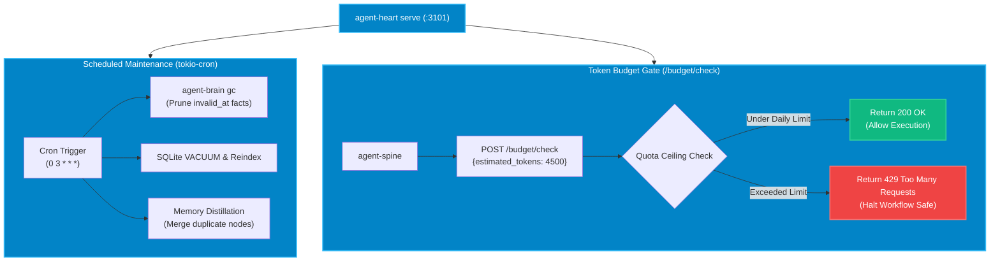

# `agent-heart` — Maintenance & Quota Controller

`agent-heart` acts as the autonomic circulatory and maintenance governor for the ecosystem. It continuously enforces **token spending ceilings**, prevents infinite LLM loop bankruptcies, and schedules background **garbage collection (GC)** routines to prevent memory index bloat.



---

## Architectural Invariants

### 1. Cost Containment & The Runaway Loop Shield
Autonomous agents given unrestricted retry loops can burn through thousands of dollars in cloud LLM credits within minutes. `agent-heart` exposes a strict HTTP `/budget/check` gate. Before any LLM-heavy task is submitted to execution, `agent-spine` must acquire a token reservation. If the daily budget ceiling is reached, execution is halted immediately and an emergency alert is broadcast.

### 2. Temporal Garbage Collection & Distillation
As agents run throughout the day, facts, logs, and AST outlines accumulate in `brain.db`. Left unchecked, SQLite databases grow fragmented and vector search latencies degrade. `agent-heart` runs nightly scheduled maintenance pulses:
- **Temporal Pruning**: Removes facts where `invalid_at < now_unix_ms`.
- **Vector Deduplication**: Identifies near-identical embedding clusters and distills them into authoritative consolidated rules.
- **Database Vacuum**: Reclaims physical disk space and rebuilds HNSW graph indexes.

---

## Configuration Reference (`~/.autonomic/config.toml`)

```toml
[heart]
port = 3101
cron_schedule = "0 3 * * *"   # 3:00 AM daily
token_daily_limit = 5000000    # 5M tokens per day
spending_ceiling_usd = 50.00
alert_webhook = "https://hooks.slack.com/services/..."

[heart.gc]
prune_expired = true
vacuum_db = true
min_retention_days = 14
max_memory_rss_mb = 1024
```

---

## CLI Command Reference

| Command | Flags | Description |
| :--- | :--- | :--- |
| **`agent-heart serve`** | `--port 3101` | Starts the background controller daemon and cron scheduler. |
| **`agent-heart gc`** | `--force`, `--dry-run` | Triggers an immediate garbage collection and vacuum cycle. |
| **`agent-heart budget check`** | `--tokens <N>` | Manually tests token budget allowance against current usage. |
| **`agent-heart status`** | `--json` | Displays current daily token consumption and scheduled maintenance jobs. |

---

## MCP Tool Reference

`agent-heart` integrates with agent hosts via the following MCP tools:

- **`heart_budget_status`**: Queries current token consumption, remaining daily quota, and active spending ceiling.
- **`heart_status`**: Returns daemon health, uptime, and cron execution logs.
- **`heart_gc`**: Triggers immediate maintenance and disk reclamation.
- **`heart_memory_distill`**: Initiates semantic distillation to deduplicate related knowledge graph entries.
