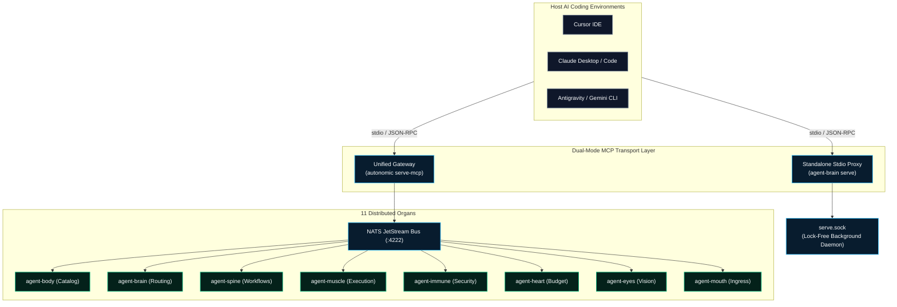

# Model Context Protocol (MCP) Integration

The Autonomic ecosystem integrates seamlessly with modern AI coding environments—including **Cursor**, **Claude Desktop**, **VSCode**, **Claude Code**, and **Antigravity**—via the [Model Context Protocol (MCP)](https://modelcontextprotocol.io/).

Autonomic supports **Dual-Mode MCP Transport**:
1. **Standalone Stdio Mode**: Individual organs (like `agent-brain`) run as independent stdio processes spawned directly by the IDE.
2. **Unified Gateway Mode**: `autonomic serve-mcp` boots as a single master MCP gateway that dynamically aggregates tool definitions across all running daemons over the internal NATS JetStream bus.



---

## The `route_task` Enforcement Gate

When an agent executes in your IDE, `agent-brain` intercepts the turn using host shell and MCP hooks:
1. **Interception**: Any attempt to run shell tools or modify files is blocked until `route_task` is called.
2. **Context Synthesis**: `route_task` evaluates the user's intent and returns a token-bounded (~500 tokens) payload of ranked skills, codebase rules, and verified recipes.
3. **Unlocking**: Once context is injected, all other tools are unlocked for the agent's turn.

---

## Editor Configuration & Quick Install

Configure your development environment with one automated command:

```bash
# Global setup: automatically detects and configures Cursor, Claude Desktop, and Claude Code
agent-brain install --global

# Target specific IDEs individually:
agent-brain install --cursor
agent-brain install --claude-desktop
agent-brain install --opencode
```

### Manual Configuration Snippet (`~/.cursor/mcp.json`)

```json
{
  "mcpServers": {
    "agent-brain": {
      "command": "agent-brain",
      "args": ["serve"]
    },
    "autonomic-cluster": {
      "command": "autonomic",
      "args": ["serve-mcp", "--all"]
    }
  }
}
```

---

## Upstream MCP Server Management

`agent-brain` acts as an MCP gateway and tool router. External MCP servers can be added, tested, and indexed directly through the CLI:

```bash
# Register an upstream MCP server
agent-brain mcp add memory-engine -- /usr/local/bin/custom-mcp-server --port 8080

# List registered servers and active tool counts
agent-brain mcp list

# Test upstream connectivity and verify tool schemas
agent-brain mcp test memory-engine

# Sync tool vectors into SQLite vector memory
agent-brain mcp sync
```

---

## Skill Packages & Curated Registry

Skills and domain policies are managed via the canonical `package` command group:

```bash
# Canonical package installation
agent-brain package add @coding-policy
agent-brain package add @supervisor
agent-brain package add owner/repo --ref main

# List installed packages and filesystem paths
agent-brain package list

# Update or remove packages
agent-brain package update
agent-brain package remove coding-policy

# Browse curated ecosystem registry
agent-brain registry list
```

