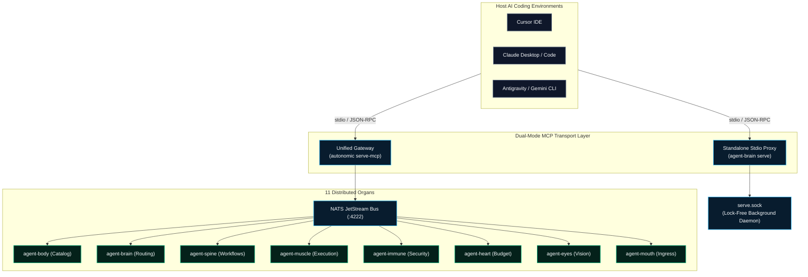

> **Out of scope.** This page describes the agent-body MCP gateway from the earlier eleven-organ design. For the MCP tools agent-brain exposes, see the [agent-brain CLI reference](/docs/cli/agent-brain).

# Model Context Protocol (MCP) Integration

The Autonomic ecosystem integrates seamlessly with modern AI coding environments—including **Cursor**, **Claude Desktop**, **VSCode**, **Claude Code**, and **Antigravity**—via the [Model Context Protocol (MCP)](https://modelcontextprotocol.io/).

Autonomic supports **Dual-Mode MCP Transport**:
1. **Standalone Stdio Mode**: Individual organs (like `agent-brain`) run as independent stdio processes spawned directly by the IDE.
2. **Unified Gateway Mode**: `autonomic serve-mcp` boots as a single master MCP gateway that dynamically aggregates tool definitions across all running daemons over the internal NATS JetStream bus.



---

## The `route_task` Enforcement Gate

When an agent executes in your IDE, `agent-brain` intercepts the turn using host shell and MCP hooks:
1. **Interception**: Any attempt to run shell tools or modify files is blocked until `route_task` is called.
2. **Context Synthesis**: `route_task` evaluates the user's intent and returns a token-bounded (~500 tokens) payload of ranked skills, codebase rules, and verified recipes.
3. **Unlocking**: Once context is injected, all other tools are unlocked for the agent's turn.

---

## Editor Configuration & Quick Install

Configure your development environment with one automated command:

```bash
# Global setup: automatically detects and configures Cursor, Claude Desktop, and Claude Code
agent-brain install --global

# Target specific IDEs individually:
agent-brain install --cursor
agent-brain install --claude-desktop
agent-brain install --opencode
```

### Manual Configuration Snippet (`~/.cursor/mcp.json`)

```json
{
  "mcpServers": {
    "agent-brain": {
      "command": "agent-brain",
      "args": ["serve"]
    },
    "autonomic-cluster": {
      "command": "autonomic",
      "args": ["serve-mcp", "--all"]
    }
  }
}
```

---

## Upstream MCP Server Management

`agent-brain` acts as an MCP gateway and tool router. External MCP servers can be added, tested, and indexed directly through the CLI:

```bash
# Register an upstream MCP server
agent-brain mcp add memory-engine -- /usr/local/bin/custom-mcp-server --port 8080

# List registered servers and active tool counts
agent-brain mcp list

# Test upstream connectivity and verify tool schemas
agent-brain mcp test memory-engine

# Sync tool vectors into SQLite vector memory
agent-brain mcp sync
```

---

## Skill Packages & Curated Registry

Skills and domain policies are managed via the canonical `package` command group:

```bash
# Canonical package installation
agent-brain package add @agstack
agent-brain package add @supervisor
agent-brain package add owner/repo --ref main

# List installed packages and filesystem paths
agent-brain package list

# Update or remove packages
agent-brain package update
agent-brain package remove coding-policy

# Browse curated ecosystem registry
agent-brain registry list
```

---

## Universal Upstream Tool Governance (`route_to_mcp`)

The central router `route_to_mcp` equips calling agents with high-performance primitives for managing external MCP servers:

### 1. Pre-Flight Schema Introspection (`describe_tool`)
Callers can inspect input parameter schemas before dispatching tools, avoiding trial-and-error argument guessing:
```json
{
  "name": "route_to_mcp",
  "arguments": {
    "server": "linear",
    "tool": "save_issue",
    "describe_tool": true
  }
}
```

### 2. Multi-Tool Batching (`batch`)
Executes an array of sequential tool calls within a single persistent child process session, eliminating repetitive process spawn and handshake overhead:
```json
{
  "name": "route_to_mcp",
  "arguments": {
    "server": "linear",
    "batch": [
      { "tool": "save_label", "arguments": { "name": "bug" } },
      { "tool": "save_issue", "arguments": { "title": "Fix crash", "team": "ENG" } }
    ]
  }
}
```

### 3. Dynamic Semantic Entity Compaction (`compact_entity`)
When token limits are constrained, arrays of objects are dynamically compacted to their core identifiers and state fields (`id`, `key`, `title`, `name`, `status`, `state`) before falling back to item omission, maximizing usable context without blowing token budgets.

---

## Token-Bounded Filesystem Tools (`agent-brain`)

To prevent catastrophic token expansion from unbounded shell commands (`ls -la`, `find`, `cat`), `agent-brain` provides first-class, token-budgeted filesystem exploration tools:

| Tool | Parameters | Purpose | Native Replacement |
| :--- | :--- | :--- | :--- |
| `list_directory` | `path`, `max_entries` (100), `include_hidden` | Lists directory entries with file types, sizes, and modified timestamps. | `ls` / `dir` |
| `find_files` | `path`, `pattern`, `extension`, `max_depth` (10) | Recursively searches files with wildcard/extension filters and depth caps. | `find` / `glob` |
| `read_file` | `path`, `start_line`, `end_line`, `max_bytes` | Reads bounded 1-indexed line ranges without loading entire files into memory. | `cat` / `sed` / `awk` |
| `file_summary` | `path` | Token-efficient file metadata, outline, and 5-line sample. | `wc` / `head` |
| `grep_search` | `path`, `pattern`, `max_matches` | Regex line search with automatic truncation and oversized-line skipping. | `grep` / `rg` |

---

## In-Gateway AST Validation & Self-Correcting Execution (`agent-body`)

The `agent-body` gateway automatically mediates shell command execution through AST safety analysis:

1. **Automated Gate Fusion**: Calls to `muscle_execute_bash` pass through `agent-mouth` AST safety validation internally. No separate roundtrip is required.
2. **Deterministic Blocking**: Destructive commands (e.g. `rm -rf /`, fork bombs, unvalidated dynamic evaluation) are rejected with exit code `126` and structured feedback detailing the offending AST pattern.
3. **Mandatory Self-Correction**: Agents are governed to diagnose and correct rejected commands rather than attempting to bypass safety gates with host commands.
4. **Resilient Auto-Recovery**: Failed organ sessions are cleanly evicted, ensuring that fallback execution does not latch onto subsequent invocations.


