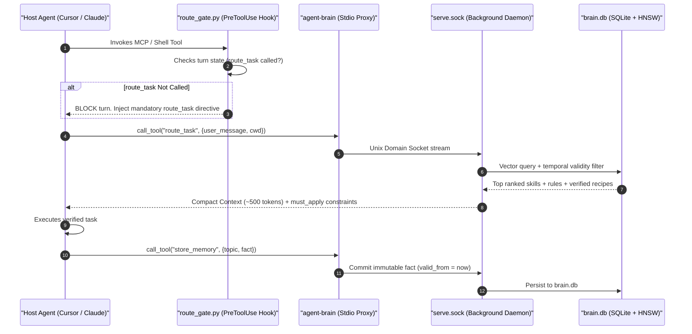

# `agent-brain` — Vector Memory & Context Router

`agent-brain` is the memory, routing, and context substrate for the Autonomic ecosystem. It solves the critical problem of **context window saturation and rule adherence drift** by selecting the exact slice of ranked skills, rules, and durable facts (~500 tokens) needed for each LLM turn, backed by a temporal SQLite Knowledge Graph and HNSW vector index.



---

## Architectural Invariants

### 1. Proxy-over-Supervised-Daemon Architecture
To prevent `database is locked` concurrency errors across concurrent IDE turns (Cursor, OpenCode, Claude Code, Antigravity), `agent-brain serve` runs as an ultra-lightweight stdio proxy connecting to `~/.autonomic/memory/serve.sock`. A single background daemon manages SQLite WAL access and in-memory HNSW vector indexes with zero lock contention.

### 2. Adaptive Outcome Scoring & Verified Recipes
Command executions verified via `agent-brain verify -- <cmd>` or recorded outcomes are automatically attributed to the active turn's `route_log_id`:
- **Success (`exit 0`)**: Rewards context relevance, reinforcing the pattern in future `route_task` calls and promoting high-confidence recipes into `must_apply` constraints.
- **Failure (`exit != 0`)**: Instantly squelches the failing command from few-shot recipe recommendations, preventing broken suggestions from propagating.

### 3. Read Tool Scout Guard
Reading multi-thousand line files consumes tokens and degrades reasoning. `agent-brain` intercepts oversized file reads and routes the agent to token-bounded scout tools: `file_summary`, `grep_search`, `read_file_head`, and `read_file_tail`.

### 4. Decoupled Dynamic Registry & `@agstack` Enforcement
Rather than bloating the `agent-brain` binary with hundreds of embedded skill files, `agent-brain` dynamically syncs packages and workflows from the central [**`agent-registry`**](https://github.com/autonomic-ai-dev/agent-registry) into `~/.autonomic/memory/registry-cache/`. 

To guarantee that autonomous agents adhere to strict engineering standards, `agent-brain` enforces the `@agstack` gold standard through five systematic pillars:
1. **Mandatory Invariants in `must_apply`**: Invariants (pure functions, immutability, zero comment slop, boundary isolation, 4-Hour Time Horizon contracts) are permanently injected into `route_task` output on every turn.
2. **Pre-Commit Zero Comment Slop Hook**: A pre-commit hook runs `check-added-comments.sh` to reject AI narration or redundant comments in code diffs.
3. **Strict Path & Ref Validation**: Package repository slugs and git refs are strictly validated to prevent traversal and injection attacks.
4. **Trap Warning Promotion**: When verification fails (`agent-brain verify`), the negative outcome promotes the memory into a prominent `TRAP WARNING: <fact>` directive in future turns.
5. **Dynamic Workflow Auto-Indexing**: Curated workflows (`@bugfix`, `@feature`, `@stacked-pr`, `@release-notes`) are automatically indexed into SQLite on registry sync and surfaced as verified recipes.

---

## MCP Tool Reference

`agent-brain` exposes the following native tools over stdio and socket:

| MCP Tool | Parameters | Purpose |
| :--- | :--- | :--- |
| **`route_task`** | `user_message`, `current_working_directory`, `open_files` | Returns ranked skills, rules, and memory (~500 tokens) for the turn. |
| **`store_memory`** | `topic`, `fact`, `scope`, `confidence`, `valid_from` | Commits durable facts (under 50 words) to temporal storage. |
| **`get_context`** | `query`, `limit`, `category` | Explicit vector similarity search against the Knowledge Graph. |
| **`file_summary`** | `path` | Returns token-compact AST outline of classes, functions, and exports. |
| **`grep_search`** | `query`, `path`, `regex` | Bounded grep search avoiding massive full-file reads. |
| **`read_file_head`** | `path`, `lines` | Reads only the initial N lines of a file. |
| **`read_file_tail`** | `path`, `lines` | Reads only the trailing N lines of a file. |

---

## CLI Command Reference

`agent-brain` provides robust command-line operations for verification and administrative maintenance:

```bash
# 1. Verify a command execution and record outcome in brain.db
agent-brain verify -- cargo test

# 2. Check health of the embedding model and vector index
agent-brain doctor

# 3. Store a durable memory manually via CLI
agent-brain memory put --topic "ci" --fact "Always pass protected-path-approved label on test changes"

# 4. Trigger vector deduplication and temporal vacuum
agent-brain gc

# 5. Global setup: configure hooks for Cursor, Claude Code, and Antigravity
agent-brain install --global

# 6. Dynamically synchronize packages and workflows from central registry
agent-brain registry sync

# 7. Install the @agstack gold standard engineering package
agent-brain package add @agstack
```

---

## Curated Package Registry (`agent-registry`)

Curated skill packages, domain engineering rules, and deterministic workflows are distributed through the decoupled [**`agent-registry`**](https://github.com/autonomic-ai-dev/agent-registry) repository.

| Package Alias | Category | Description |
| :--- | :--- | :--- |
| **`@agstack`** | Engineering OS | **Gold Standard** — Full-SDLC operating system, 11 playbooks, immutability, zero comment slop, boundary discipline, root-cause fixes |
| **`@starter`** | Onboarding | Core productivity and coding skills from Matt Pocock & Vercel Labs |
| **`@ecc`** | Comprehensive | Full Everything Claude Code (ECC) engineering library |
| **`@rust`** | Language | High-performance Rust design patterns, borrow checker safety, and clippy review |
| **`@nextjs`** | Web Framework | Modern React, Next.js App Router, and server components best practices |
| **`@bugfix`** | Workflow | Reproduce test → isolate → fix → verify → review lifecycle |
| **`@feature`** | Workflow | Intent spec → model domain → 4-H2 contract → test suite → security gate |
| **`@stacked-pr`** | Workflow | Git stacked commit chunking → branch verify → PR generation |

Running `agent-brain registry sync` refreshes local manifests and triggers vector auto-indexing, immediately making new playbooks and workflows discoverable in turn routing.

---

## Verification Policy (`.verify/verify.toml`)

Projects specify allowable verification commands to ensure untrusted scripts do not poison the knowledge graph:

```toml
[verify]
allow_unlisted = false
timeout_seconds = 120

[verify.commands]
test = "cargo test --release"
lint = "cargo clippy -- -D warnings"
fmt = "cargo fmt -- --check"
verify_suite = "bash .verify/run.sh"
```
