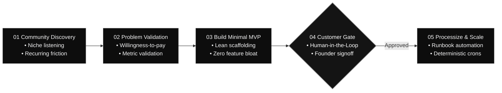

<div id="hero" class="space-y-4 not-prose mb-8">
  <div class="inline-flex items-center gap-2 px-3 py-1 rounded-full bg-white/[0.04] border border-white/10 text-xs font-mono text-neutral-300">
    <span class="w-1.5 h-1.5 rounded-full bg-white"></span>
    <span>Autonomous SDLC Specification — AGSTACK Framework</span>
  </div>

  <h1 class="text-3xl sm:text-4xl lg:text-5xl font-headline font-extrabold tracking-tight text-white leading-[1.15]">
    Minimalist Entrepreneurship — <br/>
    <span class="text-neutral-400 font-normal">
      Deterministic Product Lifecycle
    </span>
  </h1>

  <p class="text-base sm:text-lg text-neutral-300 font-body leading-relaxed max-w-3xl">
    Operationalizing the Minimalist Entrepreneur methodology into an immutable, multi-stage Directed Acyclic Graph (DAG) executed by <code class="font-mono text-white bg-white/[0.06] px-1.5 py-0.5 rounded border border-white/10">agent-spine</code>. Eliminates speculative product bloat through structured listening, customer pre-validation, lean scaffolding, and human-in-the-loop signoff gates.
  </p>
</div>

---

<section id="lifecycle-dag" class="my-10">

## The Autonomous Minimalist DAG

Instead of building speculative multi-month roadmaps, the Minimalist Entrepreneur workflow enforces milestone progression where every transition is deterministically validated before the next stage can initialize:



</section>

---

<section id="lifecycle-stages" class="my-10">

## Lifecycle Stages & Execution Bounds

<div class="space-y-8">
  <div class="p-5 rounded-2xl bg-white/[0.02] border border-white/[0.08]">
    <div class="flex items-center justify-between mb-2">
      <h3 class="text-lg font-headline font-semibold text-white">01. Community Discovery</h3>
      <span class="font-mono text-xs text-neutral-300 bg-white/[0.04] px-2 py-0.5 rounded border border-white/10">Agent Node</span>
    </div>
    <p class="text-sm text-neutral-300 leading-relaxed">
      Identifies underserved developer or operational communities. Using bounded vector queries in <code class="font-mono text-white bg-white/[0.06] px-1.5 py-0.5 rounded border border-white/10">agent-brain</code>, the agent actively parses bug trackers, GitHub issues, and developer forums to isolate high-frequency manual friction points without hallucinating unverified demand.
    </p>
  </div>

  <div class="p-5 rounded-2xl bg-white/[0.02] border border-white/[0.08]">
    <div class="flex items-center justify-between mb-2">
      <h3 class="text-lg font-headline font-semibold text-white">02. Problem Validation</h3>
      <span class="font-mono text-xs text-neutral-300 bg-white/[0.04] px-2 py-0.5 rounded border border-white/10">Agent Node</span>
    </div>
    <p class="text-sm text-neutral-300 leading-relaxed">
      Calculates concrete ROI metrics. Confirms willingness to pay and ensures the proposed solution saves tangible developer hours or cloud infrastructure spend. Synthesizes concise problem statements bounded strictly under 500 context tokens.
    </p>
  </div>

  <div class="p-5 rounded-2xl bg-white/[0.02] border border-white/[0.08]">
    <div class="flex items-center justify-between mb-2">
      <h3 class="text-lg font-headline font-semibold text-white">03. Build Minimal MVP</h3>
      <span class="font-mono text-xs text-neutral-300 bg-white/[0.04] px-2 py-0.5 rounded border border-white/10">Agent Node</span>
    </div>
    <p class="text-sm text-neutral-300 leading-relaxed">
      Scaffolds the single leanest functional implementation that solves the core validated problem. Strictly enforces AGSTACK invariants: pure production code, zero conversational comment slop, and atomic state transitions sealed with SHA-256 proofs.
    </p>
  </div>

  <div class="p-5 rounded-2xl bg-white/[0.04] border border-white/20">
    <div class="flex items-center justify-between mb-2">
      <h3 class="text-lg font-headline font-semibold text-white">04. Customer Signoff Gate</h3>
      <span class="font-mono text-xs text-white bg-white/10 px-2 py-0.5 rounded border border-white/20">Approval Gate</span>
    </div>
    <p class="text-sm text-neutral-300 leading-relaxed">
      Human-in-the-Loop milestone boundary. The engine pauses execution, serializes the complete state snapshot, and awaits explicit founder/stakeholder signoff confirming customer commitment and pricing alignment prior to release.
    </p>
  </div>

  <div class="p-5 rounded-2xl bg-white/[0.02] border border-white/[0.08]">
    <div class="flex items-center justify-between mb-2">
      <h3 class="text-lg font-headline font-semibold text-white">05. Processize & Scale</h3>
      <span class="font-mono text-xs text-neutral-300 bg-white/[0.04] px-2 py-0.5 rounded border border-white/10">Agent Node</span>
    </div>
    <p class="text-sm text-neutral-300 leading-relaxed">
      Generates automated operational runbooks, deterministic cron scripts, and monitoring probes. Transitions verified product logic into maintenance mode with continuous regression safeguards in <code class="font-mono text-white bg-white/[0.06] px-1.5 py-0.5 rounded border border-white/10">.verify/</code>.
    </p>
  </div>
</div>

</section>

---

<section id="workflow-execution" class="my-10">

## Executing via agent-spine

The workflow is registered in the Autonomic Registry and can be dispatched deterministically using the <code class="text-indigo-400 font-mono">agent-spine</code> CLI:

```bash
# Execute the minimalist entrepreneur workflow DAG
agent-spine run --workflow minimalist-entrepreneur

# Resume after founder customer signoff gate approval
agent-spine resume --run-id run_me_91a0fbf --node ProcessizeAndScale

# Inspect immutable milestone receipts
agent-spine status --run-id run_me_91a0fbf
```

</section>
