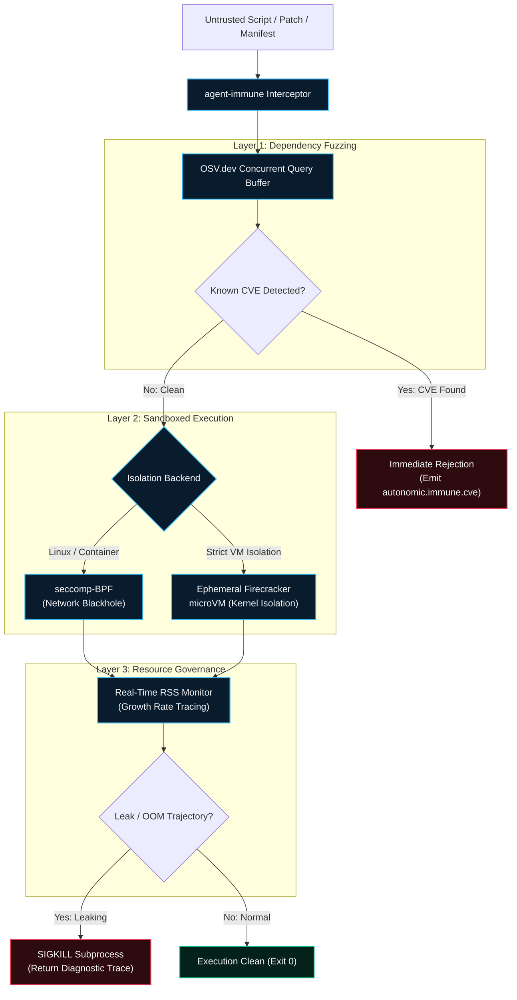

# `agent-immune` — Zero-Trust Security & Admission

`agent-immune` is the **Open Policy Agent (OPA) & Zero-Trust Admission Controller** for the Autonomic cluster. Because AI agents routinely generate and execute untrusted code, running that code directly on bare-metal host machines represents an existential security risk. `agent-immune` enforces strict admission boundaries, scanning dependencies against the [OSV.dev](https://osv.dev) vulnerability database, wrapping execution in **Firecracker microVMs** or **seccomp-BPF filters**, and aggressively killing runaway processes that exhibit OOM trajectories.



---

## Architectural Invariants

### 1. Concurrent Dependency Fuzzing (OSV.dev)
Before generated dependencies or lockfiles (`Cargo.toml`, `package.json`, `requirements.txt`) are resolved, `agent-immune` parses the AST and queries the Google OSV.dev vulnerability database using a concurrent `tokio` buffer. If any dependency contains an unpatched critical vulnerability (CVSS > 8.0), admission is immediately blocked and a security hold is placed on the active workflow.

### 2. Multi-Backend Sandboxing
Depending on host operating system capabilities, `agent-immune` dynamically selects the strongest available isolation backend:
- **`process`**: Lightweight subprocess execution with restricted environment variables and stripped credentials.
- **`seccomp`**: Uses Linux seccomp-BPF syscall filtering to completely blackhole unauthorized network egress sockets.
- **`firecracker`**: Boots an ephemeral, hardware-isolated Firecracker microVM in under 150ms, executes the untrusted payload inside the microVM, extracts the result, and immediately destroys the VM.

### 3. Runaway Memory & Infinite Loop Termination
Agents frequently generate accidental infinite loops (`while True`) that leak memory until the host crashes. `agent-immune` samples peak Resident Set Size (RSS) and memory gradient curves every 10ms. If memory usage spikes exponentially toward the configured ceiling (e.g., >512MB), it sends an aggressive `SIGKILL`, dumps the memory profile, and returns an actionable diagnostic trace to the LLM so it can rewrite the loop.

---

## Configuration Reference (`~/.autonomic/config.toml`)

```toml
[immune]
port = 3106
sandbox_backend = "process"      # Options: "process", "seccomp", "firecracker"
network_blackhole = true
max_memory_rss_mb = 512
osv_cache_ttl_hours = 24
auto_abort_on_high_cve = true
```

---

## CLI Command Reference

| Command | Flags | Description |
| :--- | :--- | :--- |
| **`agent-immune scan`** | `--manifest <path>`, `--json` | Scans dependency manifests against the OSV.dev CVE database. |
| **`agent-immune sandbox run`** | `"<cmd>"`, `--backend <type>` | Executes a command inside the zero-trust sandbox. |
| **`agent-immune verify-memory`** | `--pid <pid>`, `--ceiling-mb <N>` | Attaches real-time RSS monitor to an existing process PID. |
| **`agent-immune serve`** | `--port 3106` | Starts the admission control HTTP server. |

---

## MCP Tool Reference

`agent-immune` protects agent hosts via the following MCP tools:

- **`immune_scan_manifest`**: Parses and checks a package file for known CVEs.
- **`immune_sandbox_run`**: Sandboxes an arbitrary script, enforcing strict syscall and memory ceilings.
