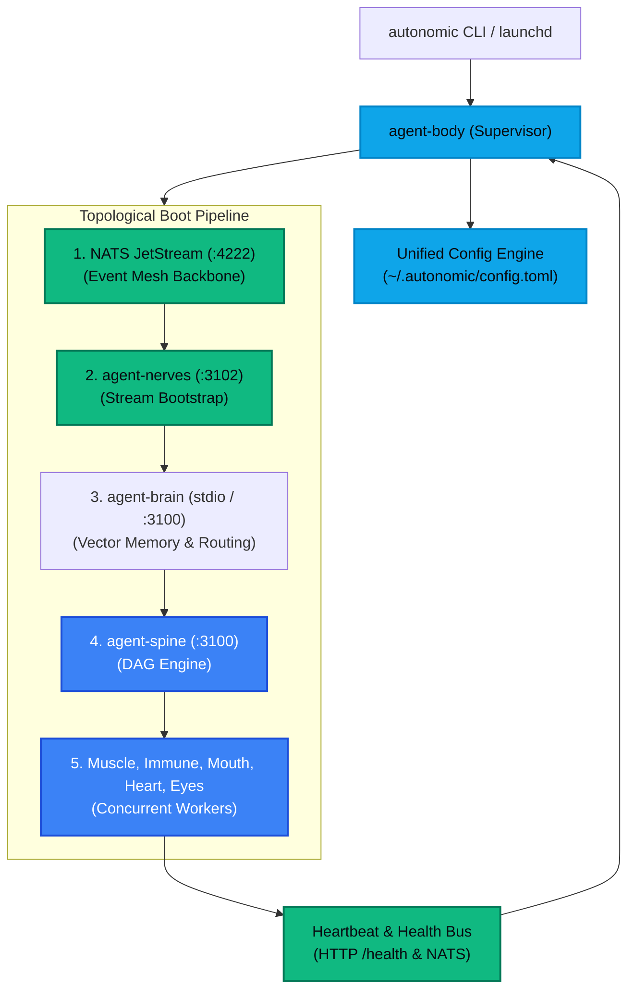

# `agent-body` — The Autonomic Control Plane

`agent-body` serves as the **Control Plane & Process Supervisor** (`kubectl` / `systemd` analog) for the Autonomic AI cluster. Built in high-performance Rust, it provides the **`autonomic`** meta-CLI, governs the shared `~/.autonomic/` filesystem workspace, and acts as the local process supervisor for all isolated organ daemons.

Without `agent-body`, operators must manually boot, configure, probe, and orchestrate 8+ background daemons in separate terminal windows. With `agent-body`, a single deterministic command boots the entire cluster in verified topological sequence.



---

## Architectural Invariants

### 1. Topological Boot Ordering
Organs have strict dependency hierarchies. `agent-body` enforces this via a deterministic topological sort:
1. Spawns the embedded or local **NATS JetStream** broker on port `4222`.
2. Probes the broker socket until `READY`, then boots **`agent-nerves`** to claim the `AUTONOMIC` stream.
3. Spawns **`agent-brain`** to open the temporal SQLite database and HNSW vector index at `~/.autonomic/memory/serve.sock`.
4. Concurrently boots the remaining specialized daemons (`muscle`, `immune`, `heart`, `mouth`, `eyes`).
5. Exposes the unified MCP gateway on stdio or Unix sockets.

### 2. Isolated Microservices & Auto-Healing
Autonomic rejects monolithic Python execution. Each organ is compiled as a distinct, standalone Rust binary. If a runaway process leaks memory or triggers a segmentation fault, only that isolated process terminates. `agent-body` captures the exit signal, writes diagnostic traces, and triggers an **exponential backoff restart** without taking down the cluster.

### 3. macOS launchd Daemonization
On macOS, `agent-body` integrates natively with `launchd`. It generates and registers a persistent LaunchAgent plist (`~/Library/LaunchAgents/dev.autonomic.agent-body.plist`), ensuring the cluster starts upon user login and survives machine reboots.

---

## CLI Command Reference

`agent-body` exposes the unified **`autonomic`** meta-command:

| Command | Arguments / Flags | Description |
| :--- | :--- | :--- |
| **`autonomic init`** | `--force`, `--path <dir>` | Scaffolds `~/.autonomic/` directory tree and baseline `config.toml`. |
| **`autonomic start`** | `--foreground`, `--daemon` | Boots the full organ cluster in topological order. |
| **`autonomic stop`** | `--graceful <secs>`, `--force` | Gracefully drains JetStream consumers and halts all daemons. |
| **`autonomic restart`** | `[organ]` | Restarts the cluster or an individual organ daemon. |
| **`autonomic status`** | `--json` | Probes HTTP `/health` endpoints and displays PID/RSS matrix. |
| **`autonomic doctor`** | `--fix` | Verifies binary signatures, ports, sockets, and Homebrew paths. |
| **`autonomic logs`** | `-f`, `--organ <name>` | Tails unified, multiplexed color-coded logs across all daemons. |
| **`autonomic serve-mcp`** | `--all`, `--port <port>` | Aggregates tools across all active organs into a single MCP gateway. |

### Example CLI Workflows

```bash
# 1. Initialize environment
autonomic init

# 2. Run ecosystem diagnostics
autonomic doctor

# 3. Boot cluster in background
autonomic start

# 4. Inspect organ health status
autonomic status

# 5. Tail real-time unified logs
autonomic logs -f --organ brain
```

---

## Configuration Reference (`~/.autonomic/config.toml`)

All 11 organs read their startup configurations from a single centralized configuration file:

```toml
[autonomic]
cluster_id = "local-dev"
environment = "development"
state_dir = "~/.autonomic/state"

[supervisor]
auto_restart = true
max_restarts = 5
restart_backoff_ms = 1000
log_level = "info"

[broker]
nats_url = "nats://127.0.0.1:4222"
stream_name = "AUTONOMIC"
retention = "limits"
max_bytes = 1073741824 # 1GB

[ports]
spine = 3100
heart = 3101
nerves = 3102
muscle = 3103
mouth = 3104
eyes = 3105
immune = 3106
```

---

## Catalog Discovery MCP Protocol

`agent-body` implements `get_autonomic_catalog`, an MCP tool that allows client LLMs to discover the active organ mesh without triggering route gates:

```json
{
  "name": "get_autonomic_catalog",
  "description": "Returns full specifications, active endpoints, and available tools across all 11 organs",
  "parameters": {
    "type": "object",
    "properties": {
      "filter_tier": {
        "type": "string",
        "enum": ["all", "core", "execution", "sensory", "interface"]
      }
    }
  }
}
```
