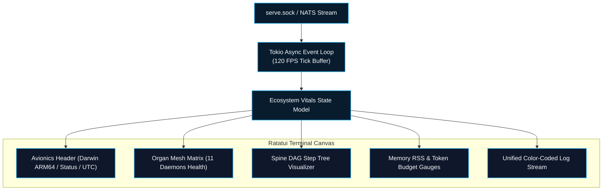

# `agent-tui` — Terminal Observability HUD

`agent-tui` is the terminal-native observability console for the Autonomic AI ecosystem. Built with **Ratatui** and **Crossterm** in Rust, it renders an aerospace-grade avionics HUD inside the developer's terminal, streaming live organ telemetry, memory graph vitals, and DAG execution traces with sub-millisecond refresh rates and zero CPU overhead.



---

## Architectural Invariants

### 1. Direct Socket Streaming (Zero Polling Overhead)
Unlike web UIs that rely on periodic HTTP polling intervals, `agent-tui` connects directly to the Unix Domain Socket (`~/.autonomic/memory/serve.sock`) or the NATS JetStream telemetry subject (`autonomic.telemetry.*`). State updates are pushed reactively; idle terminal CPU consumption remains under 0.1%.

### 2. Ratatui Double-Buffered Canvas
The TUI uses double-buffered terminal rendering via `ratatui`. Screen redraws calculate minimal character diffs, eliminating screen flicker even when high-velocity logs and 100+ node DAG executions stream concurrently.

### 3. Integrated Keyboard Command Matrix
Operators can navigate through running DAGs, zoom into failure logs, trigger manual garbage collection pulses, or pause workflows directly from the keyboard without touching a mouse.

---

## Keyboard Navigation & Shortcuts

| Keybinding | Action | Description |
| :--- | :--- | :--- |
| **`Tab` / `Shift+Tab`** | Switch Active Panel | Cycles focus between Organ Mesh, DAG Visualizer, and Logs. |
| **`6` / `u`** | Jump to Tab 6 | Opens dedicated **USAGE & BUDGET** HUD panel. |
| **`j` / `k`** or **`↑` / `↓`**| Navigate Items | Scrolls through active nodes, PR lists, or log history. |
| **`Enter`** | Expand Node Details | Opens detailed stdout, stderr, and snapshot metadata for a step. |
| **`g`** | Trigger Manual GC | Sends an immediate garbage collection signal to `agent-heart`. |
| **`r`** | Rerun Step | Prompts `agent-spine` to replay execution from previous snapshot. |
| **`q` / `Esc`** | Detach Console | Gracefully disconnects from socket without stopping background daemons. |

---

## Tab 6: USAGE & BUDGET Mission Control HUD
Pressing `6` or `u` switches into the mission control usage telemetry HUD:
- **Token Breakdown**: Displays real-time counts for prompt tokens, completion tokens, cached reads, and total cache hit percentage.
- **Spend vs Ceiling Gauge**: Visualizes daily and monthly budget utilization with dynamic color-coding (Cyber Green under 80%, Cyber Yellow at warning threshold, Cyber Red on critical breach).
- **Organ Attribution Matrix**: Tracks exact token expenditure broken down across `agent-brain`, `agent-muscle`, `agent-spine`, and subagents.

---

## CLI Command Reference

```bash
# 1. Launch terminal HUD connecting to local default socket
agent-tui

# 2. Connect to a custom socket path or remote cluster proxy
agent-tui --socket ~/.autonomic/memory/serve.sock

# 3. Specify terminal refresh rate (Hz)
agent-tui --fps 60

# 4. Filter HUD to a specific organ subsystem
agent-tui --organ spine
```
