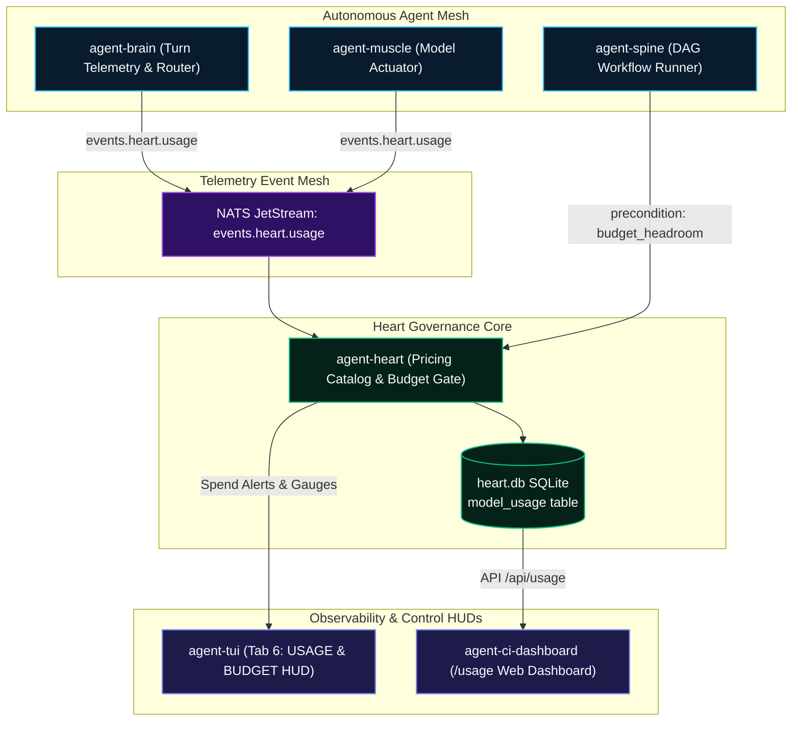

# Model Usage & Budget Governance

Autonomous AI systems operating continuously across multiple repositories and subagents require strict **token governance, spend attribution, and runtime cost controls**. Without preventative safeguards, cascading agent retries and unthrottled prompts can quickly exhaust API quotas or incur unexpected cloud spend.

The Autonomic AI ecosystem introduces a unified, organ-wide **Model Usage & Budget Governance** framework that tracks token metrics in real time, attests prompt cache savings, and halts execution before exceeding configured cost ceilings.



---

## Architectural Highlights

### 1. Unified Data Model & Standard Pricing Catalog (`agent-heart`)
- **`ModelUsageRecord`**: Records input tokens, output tokens, cached tokens, model identifier, organ attribution, and timestamp.
- **`PricingCatalog`**: Built-in cost calculation table covering major model providers (OpenAI GPT-4o, Anthropic Claude 3.5 Sonnet / Haiku, Google Gemini 2.5 Pro / Flash, DeepSeek, and local Ollama / vLLM models at $0.00).
- **SQLite Storage**: Persistent `model_usage` table in `heart.db` with time-bucket indices for sub-millisecond query aggregation.

### 2. High-Throughput JetStream Event Pipeline (`agent-nerves`)
- Organ runtimes publish asynchronous usage events to the NATS JetStream stream `events.heart.usage`.
- Decouples LLM execution from telemetry storage: agents report usage without blocking worker threads.
- Supports durable file retention, consumer replay, and broadcast to terminal HUDs.

### 3. Turn Telemetry & Cache Savings Attribution (`agent-brain`)
- Automatically records per-turn context sizes, prompt cache hits, and generated completion tokens via MCP tools `record_turn_telemetry` and `get_cache_savings_summary`.
- Quantifies exact dollar savings achieved through vector memory deduplication and prompt caching.

### 4. Workflow Budget Preconditions & Cost Gates (`agent-spine`)
- Workflows declare maximum budget limits in their YAML manifest (`max_cost_usd` or `max_tokens`).
- Individual DAG nodes enforce budget headroom checks before running:
  ```yaml
  nodes:
    - id: deep_code_analysis
      command: "agent-brain query --deep"
      preconditions:
        - check: budget_headroom
          min_remaining_usd: 5.00
        - check: quota_available
          provider: anthropic
          max_utilization_pct: 85.0
  ```
  If budget headroom is insufficient, `agent-spine` safely pauses or halts the workflow before incurring debt.

### 5. Multi-Surface Mission Control Telemetry
- **Terminal UI (`agent-tui`)**: Dedicated **Tab 6: USAGE & BUDGET** providing a real-time terminal HUD with token breakdowns, spend vs ceiling gauges, and organ-level attribution tables.
- **Web Dashboard (`agent-ci-dashboard`)**: Modern web dashboard at `/usage` displaying fleet spend, cache hit rates, model market share, and top agent consumers.

---

## MCP Governance Tools

Agents can inspect budgets and log usage directly via standard MCP tool calls:

```json
// Inspect remaining daily and monthly spend capacity
{
  "name": "heart_check_budget",
  "arguments": {
    "estimated_tokens": 10000,
    "model": "claude-3-5-sonnet"
  }
}
```

```json
// Retrieve fleet usage summary for the last 24 hours
{
  "name": "heart_get_usage_summary",
  "arguments": {
    "since_unix_ms": 1729100000000,
    "group_by": "organ"
  }
}
```
