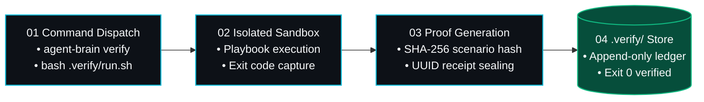

<div id="hero" class="space-y-4 not-prose mb-8">
  <div class="inline-flex items-center gap-2 px-3 py-1 rounded-full bg-cyan-950/70 border border-cyan-500/30 text-xs font-mono text-cyan-300">
    <span class="w-2 h-2 rounded-full bg-cyan-400 animate-pulse"></span>
    <span>Verification Engine — Deterministic Harness</span>
  </div>

  <h1 class="text-3xl sm:text-4xl lg:text-5xl font-headline font-extrabold tracking-tight text-white leading-[1.15]">
    Deterministic Verification <br/>
    <span class="bg-clip-text text-transparent bg-gradient-to-r from-emerald-400 via-cyan-300 to-indigo-400">
      The .verify/ Proof Harness
    </span>
  </h1>

  <p class="text-base sm:text-lg text-slate-300 font-body leading-relaxed max-w-3xl">
    In Autonomic AI, claims of test success or code correctness are never accepted from conversational statements. Every claim must be backed by a cryptographically sealed verification record generated through <code class="text-cyan-400 font-mono">agent-brain verify</code> that exited 0.
  </p>
</div>

---

<section id="verification-pipeline" class="my-10">

## Verification Pipeline & Proof Generation

The verification harness enforces a strict boundary between application runtime code and immutable test receipts:



</section>

---

<section id="core-pillars" class="my-10">

## Architectural Invariants of the Harness

<div class="grid grid-cols-1 md:grid-cols-2 gap-6 my-6">
  <div class="p-5 rounded-2xl bg-slate-900/40 border border-white/[0.08]">
    <div class="flex items-center gap-2 mb-2">
      <span class="text-emerald-400 font-mono text-sm">01</span>
      <h3 class="text-base font-headline font-semibold text-white">Verification Root Separation</h3>
    </div>
    <p class="text-xs text-slate-300 leading-relaxed">
      All generated test harnesses, snapshots, logs, and artifacts MUST output strictly to <code class="text-cyan-300 font-mono">.verify/</code>. Reference test fixtures remain strictly read-only to prevent agents from modifying test expectations to fake passing results.
    </p>
  </div>

  <div class="p-5 rounded-2xl bg-slate-900/40 border border-white/[0.08]">
    <div class="flex items-center gap-2 mb-2">
      <span class="text-emerald-400 font-mono text-sm">02</span>
      <h3 class="text-base font-headline font-semibold text-white">Hard Exit Code 0 Invariant</h3>
    </div>
    <p class="text-xs text-slate-300 leading-relaxed">
      No agent is permitted to claim a task is complete or that checks pass without a recorded execution that exited with return code 0. Any non-zero exit immediately breaks execution and triggers root-cause fault isolation.
    </p>
  </div>

  <div class="p-5 rounded-2xl bg-slate-900/40 border border-white/[0.08]">
    <div class="flex items-center gap-2 mb-2">
      <span class="text-emerald-400 font-mono text-sm">03</span>
      <h3 class="text-base font-headline font-semibold text-white">Cryptographic Scenario Sealing</h3>
    </div>
    <p class="text-xs text-slate-300 leading-relaxed">
      Every execution calculates a SHA-256 hash of the entire scenario tree and git working directory. Proof receipts verify that the exact tree tested is identical to the tree committed.
    </p>
  </div>

  <div class="p-5 rounded-2xl bg-slate-900/40 border border-white/[0.08]">
    <div class="flex items-center gap-2 mb-2">
      <span class="text-emerald-400 font-mono text-sm">04</span>
      <h3 class="text-base font-headline font-semibold text-white">Playbook Modularity</h3>
    </div>
    <p class="text-xs text-slate-300 leading-relaxed">
      Playbooks reside under <code class="text-cyan-300 font-mono">.verify/playbooks/*.sh</code>. Each playbook targets a specific boundary: formula versioning, schema verification, regression suites, or static type-checking.
    </p>
  </div>
</div>

</section>

---

<section id="proof-receipt-format" class="my-10">

## Proof Receipt Schema

When a verification command executes, <code class="text-cyan-400 font-mono">agent-brain</code> emits an immutable JSON verification receipt:

```json
{
  "id": "e51b3d08-69e6-41a2-9288-4ab55c202a4a",
  "exit_code": 0,
  "success": true,
  "cause_tag": null,
  "verify_config_hash": null,
  "scenario_dir_hash": "eb202b33a35e9636c6397d45677290748cc969bc60c2a6729d2bcf24e597f7d5",
  "cmd": "bash .verify/run.sh",
  "source": "cli",
  "verify_root": "/Volumes/Seagate/developer/personal/autonomic-ai-dev/website"
}
```

</section>

---

<section id="cli-usage" class="my-10">

## Running Verification via CLI

Dispatch test suites through the verification wrapper:

```bash
# Execute local verification suite through agent-brain
agent-brain verify -- bash .verify/run.sh

# Run specific playbook directly
agent-brain verify -- bash .verify/playbooks/verify_versioning_and_docs.sh

# Inspect verification history and last passing receipts
agent-brain verify status
```

</section>
