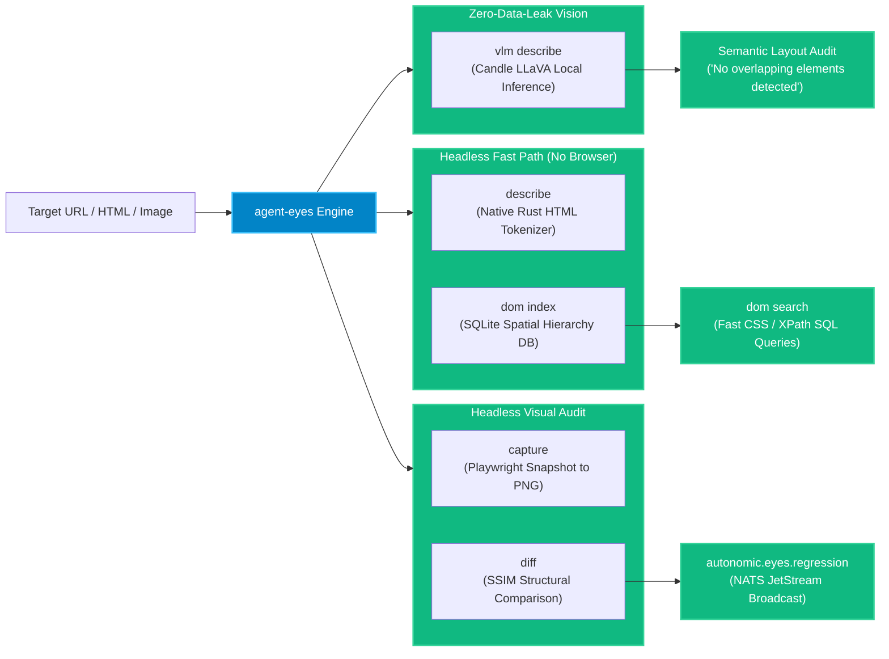

# `agent-eyes` — Visual Observability & DOM Auditing

`agent-eyes` provides **UI state extraction, visual regression testing, and on-device vision intelligence** for autonomous agents. Re-parsing a massive HTML payload on every LLM turn wastes context window limits; raw pixel diffs are brittle to 1px padding shifts. `agent-eyes` solves both by indexing semantic DOM state into local SQLite databases, running SSIM structural diffs, and performing zero-data-leak local VLM inference via Candle.

---

## Architectural Invariants

### 1. Headless Structure Extraction (Sub-Millisecond DOM)
Instead of launching a heavyweight Chromium instance (Playwright/Puppeteer) just to check if a navigation bar or button exists, `agent-eyes` tokenizes raw HTML natively in Rust. It rapidly strips noise (scripts, base64 data, tracking tags) and emits a compressed, hierarchical JSON structure fast enough to run on every turn without overhead.

### 2. Spatial DOM Indexing in SQLite
When an agent crawls or modifies a complex web application, `agent-eyes` indexes element bounding boxes, text nodes, computed styles, and accessibility roles into a local SQLite table (`dom index`). The agent can query elements using fast SQL or CSS selectors (`dom search`) without having to load the whole DOM tree into its prompt.

### 3. Structural Similarity (SSIM) Pixel Diffing
To detect visual layout regressions, `agent-eyes` compares generated screenshots against baseline images using the **Structural Similarity Index (SSIM)** algorithm. Unlike crude pixel-by-pixel comparisons that trigger false alarms on font smoothing or minor anti-aliasing variations, SSIM focuses on luminance, contrast, and structural patterns.

### 4. Local VLM (Zero-Data-Leak Vision)
Sending proprietary enterprise UI screenshots to external third-party APIs violates compliance standards. `agent-eyes` integrates local **LLaVA / Moondream vision models** executed natively via the **Candle** framework on Apple Silicon Metal or CUDA GPUs.

---

## CLI Command Reference

| Command | Flags | Description |
| :--- | :--- | :--- |
| **`agent-eyes describe`** | `<file.html>`, `--json` | Extracts semantic DOM hierarchy without launching a browser. |
| **`agent-eyes capture`** | `<url>`, `--output <path.png>` | Captures a high-resolution full-page screenshot. |
| **`agent-eyes diff`** | `<before.png>`, `<after.png>` | Runs SSIM comparison and outputs visual diff heatmap. |
| **`agent-eyes dom index`** | `<url>`, `--db <path>` | Indexes webpage elements into spatial SQLite tables. |
| **`agent-eyes dom search`** | `"<selector>"`, `--db <path>` | Queries indexed elements by selector or text match. |
| **`agent-eyes vlm describe`** | `<image.png>`, `--prompt "..."`| Runs local vision inference via Candle on Apple Silicon Metal. |

---

## MCP Tool Reference

`agent-eyes` exposes the following native tools for agents:

- **`eyes_describe_dom`**: Returns semantic interactive element outlines for a given HTML file or URL.
- **`eyes_diff_screenshots`**: Compares two screenshot files and returns an SSIM score and diff mask.
- **`eyes_vlm_caption`**: Runs local on-device VLM image captioning and semantic QA.
