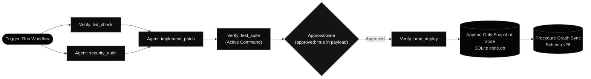

# `agent-spine` — Deterministic Workflow Engine

`agent-spine` is the deterministic execution engine for the Autonomic AI cluster. Instead of relying on unconstrained, probabilistic agent loops that can drift or hallucinate, `agent-spine` executes multi-step procedures through version-controlled Directed Acyclic Graphs (DAGs) with **immutable state snapshots**, **active command verification**, and **Human-in-the-Loop (HITL) approval gates**.



---

## Architectural Pillars

### 1. Active Verification over Passive Observation
`Verify` nodes actively execute specified shell validation commands under timeouts, capturing stdout, stderr, and exit codes. Successful runs (`exit 0`) mark the step `verified = true`, while failures halt the pipeline unless `continue_on_failure: true` is explicitly configured.

### 2. Cognitive Knapsack Injection via `agent-brain`
With `--brain`, `agent-spine` queries `agent-brain route_task` before an `Agent` node executes and injects a token-budgeted `_brain_knapsack` of relevant skills, invariant rules, and traps into the node payload. This prevents worker agents from suffering from context bloat or hallucinating rules.

### 3. Time-Travel Debugging via Immutable Snapshots
Every successful node transition creates an append-only snapshot in `state.db`. Inspect a run's history with `agent-spine inspect <EXECUTION_ID>` and recreate its final state with `agent-spine replay <EXECUTION_ID>`. There is no resume flag: to re-run after a failure, fix the cause and run the workflow again.

### 4. Zero-Daemon Local Execution with Durable DLQ
In local development environments without an external message broker, `agent-spine` automatically falls back to an embedded SQLite event log and persists failed nodes to `~/.autonomic/state/spine/dlq.jsonl`, providing full durability with zero daemon dependencies.

### 5. Speculative Multi-Branch Worktrees
For non-deterministic or high-risk engineering tasks, `SpeculativeFork` nodes spin up isolated Git worktrees concurrently. The first branch to satisfy verification criteria is merged into the mainline execution snapshot, and temporary worktrees are pruned cleanly.

---

## The Node Kinds (`NodeKind`)

| Kind | Purpose | Runtime Behavior |
| :--- | :--- | :--- |
| **`Agent`** | Discrete cognitive subtask | Hydrates a 350–700 token knapsack from `agent-brain`, delegates to worker, snapshots output |
| **`Verify`** | Machine validation | Actively executes `command`, captures exit code and output streams, asserts `verified` |
| **`ApprovalGate`** | Human-in-the-loop safety | Auto-approves by default. When auto-approval is turned off, waits until the node payload carries `approved: true` |
| **`SpeculativeFork`** | Parallel exploration | Evaluates multiple candidate branches in isolated Git worktrees |
| **`Fork` / `Join`** | Concurrency barrier | Fans out across parallel branches, continuing only when all dependencies resolve |
| **`Debate`** | Iterative refinement | Alternates between coder and critic agents in multi-turn feedback rounds |
| **`Vote`** | Consensus sampling | Runs prompt N times with temperature variance, selecting highest-quality output |
| **`Router`** | Dynamic edge branching | Computes variables used in conditional edge expressions |
| **`Hydrate`** | Context gathering | Collects environment diagnostics (diffs, test outputs) prior to execution |
| **`Checkpoint`** | Audit synchronization | Explicit append-only point-in-time state barrier |

---

## Authoring Declarative Workflows

Workflows are defined in clear, version-controlled YAML files:

```yaml
name: bugfix_pipeline
version: 1
description: "Reproduce, isolate, fix, and verify a bug with human sign-off"
start_node: reproduce_failure

nodes:
  - name: reproduce_failure
    kind: verify
    command: "cargo test --test reproduce_bug"
    description: "Run the reproduction test"

  - name: isolate_and_patch
    kind: agent
    description: "Analyze test failure, isolate root cause, and apply minimal patch"
    retry_policy:
      max_attempts: 2
      backoff_ms: 1000

  - name: verify_fix
    kind: verify
    command: "cargo test --all-features"
    description: "Confirm all tests pass after the patch"

  - name: sign_off
    kind: approval_gate
    description: "Operator sign-off before committing changes"

edges:
  - from: reproduce_failure
    to: isolate_and_patch
  - from: isolate_and_patch
    to: verify_fix
  - from: verify_fix
    to: sign_off
```

Check a file with `agent-spine validate <file>`. The built-in workflows are listed by `agent-spine init --with list`.

---

## CLI Reference

```bash
# Validate workflow DAG acyclicity and syntax
agent-spine validate workflows/bugfix_pipeline.yaml

# Run a workflow synchronously; -p passes a JSON payload, -b enables agent-brain routing
agent-spine run workflows/bugfix_pipeline.yaml -p '{"ticket": "BUG-42"}' -b

# Inspect the history of one execution, or recreate its final state
agent-spine inspect <EXECUTION_ID>
agent-spine replay <EXECUTION_ID>

# Check the capabilities planned for the current scaffold
agent-spine status

# Start the live dashboard API (:3000) and dashboard (:3001)
agent-spine serve

# Serve the MCP stdio server for IDE hosts
agent-spine mcp-serve
```

---

## MCP Tool Reference

When running in MCP mode (`agent-spine mcp-serve`), the engine exposes native tools for IDE integration:

- **`spine_submit_workflow`**: Submits a YAML workflow and returns its workflow ID.
- **`spine_check_status`**: Reports the status of a workflow execution.
- **`spine_list_workflows`**: Lists workflow executions.
