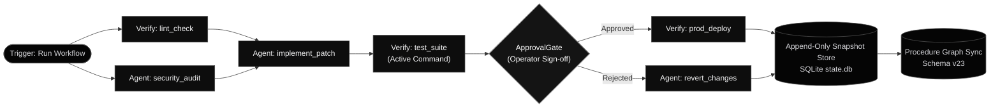

# `agent-spine` — Deterministic Workflow Engine

`agent-spine` is the deterministic execution engine for the Autonomic AI cluster. Instead of relying on unconstrained, probabilistic agent loops that can drift or hallucinate, `agent-spine` executes multi-step procedures through version-controlled Directed Acyclic Graphs (DAGs) with **immutable state snapshots**, **active command verification**, and **Human-in-the-Loop (HITL) approval gates**.



---

## Architectural Pillars

### 1. Active Verification over Passive Observation
`Verify` nodes actively execute specified shell validation commands under timeouts, capturing stdout, stderr, and exit codes. Successful runs (`exit 0`) mark the step `verified = true`, while failures halt the pipeline unless `continue_on_failure: true` is explicitly configured.

### 2. Cognitive Knapsack Injection via `agent-brain`
Before an `Agent` node executes, `agent-spine` queries `agent-brain route_task` to inject a surgical ~500-token `_brain_knapsack` containing relevant skills, invariant rules, and traps directly into the node payload. This prevents worker agents from suffering from context bloat or hallucinating rules.

### 3. Time-Travel Debugging via Immutable Snapshots
Every successful node transition creates an append-only snapshot in `state.db`. Operators can rewind to any prior sequence index via CLI (`agent-spine run --resume <seq>`) or trigger a 1-click **"↺ Replay From Here"** action directly from the dashboard.

### 4. Zero-Daemon Local Execution with Durable DLQ
In local development environments without an external message broker, `agent-spine` automatically falls back to an embedded SQLite event log and persists failed nodes to `~/.autonomic/state/spine/dlq.jsonl`, providing full durability with zero daemon dependencies.

### 5. Speculative Multi-Branch Worktrees
For non-deterministic or high-risk engineering tasks, `SpeculativeFork` nodes spin up isolated Git worktrees concurrently. The first branch to satisfy verification criteria is merged into the mainline execution snapshot, and temporary worktrees are pruned cleanly.

---

## The Node Kinds (`NodeKind`)

| Kind | Purpose | Runtime Behavior |
| :--- | :--- | :--- |
| **`Agent`** | Discrete cognitive subtask | Hydrates ~500-token knapsack from `agent-brain`, delegates to worker, snapshots output |
| **`Verify`** | Machine validation | Actively executes `command`, captures exit code and output streams, asserts `verified` |
| **`ApprovalGate`** | Human-in-the-loop safety | Suspends execution and awaits operator `agent-spine approve` or dashboard button |
| **`SpeculativeFork`** | Parallel exploration | Evaluates multiple candidate branches in isolated Git worktrees |
| **`Fork` / `Join`** | Concurrency barrier | Fans out across parallel branches, continuing only when all dependencies resolve |
| **`Debate`** | Iterative refinement | Alternates between coder and critic agents in multi-turn feedback rounds |
| **`Vote`** | Consensus sampling | Runs prompt N times with temperature variance, selecting highest-quality output |
| **`Router`** | Dynamic edge branching | Computes variables used in conditional edge expressions |
| **`Hydrate`** | Context gathering | Collects environment diagnostics (diffs, test outputs) prior to execution |
| **`Checkpoint`** | Audit synchronization | Explicit append-only point-in-time state barrier |

---

## Authoring Declarative Workflows

Workflows are defined in clear, version-controlled YAML files:

```yaml
version: 1
name: bugfix_pipeline
description: "Reproduce, isolate, fix, and verify a bug with human sign-off"

nodes:
  - id: reproduce_failure
    kind: verify
    command: "cargo test --test reproduce_bug"
    continue_on_failure: true

  - id: isolate_and_patch
    kind: agent
    depends_on: [reproduce_failure]
    description: "Analyze test failure, isolate root cause, and apply minimal patch"
    retry:
      max_attempts: 2
      backoff_ms: 1000

  - id: verify_fix
    kind: verify
    depends_on: [isolate_and_patch]
    command: "cargo test --all-features"

  - id: sign_off
    kind: approval_gate
    depends_on: [verify_fix]
    description: "Operator sign-off before committing changes"
```

---

## CLI Reference

```bash
# Validate workflow DAG acyclicity and syntax
agent-spine validate workflows/bugfix_pipeline.yaml

# Run workflow synchronously with live terminal progress
agent-spine run workflows/bugfix_pipeline.yaml

# Resume execution from a specific immutable state snapshot
agent-spine run workflows/bugfix_pipeline.yaml --resume 3

# Inspect real-time status of active or completed workflows
agent-spine status

# Human-in-the-Loop: approve or reject a paused ApprovalGate node
agent-spine approve <workflow_id> --step sign_off
agent-spine reject <workflow_id> --step sign_off --reason "Fails security audit"

# Start the local event bus and Svelte dashboard on port 3100
agent-spine serve
```

---

## MCP Tool Reference

When running in MCP mode (`agent-spine mcp-serve`), the engine exposes native tools for IDE integration:

- **`spine_submit_workflow`**: Submits a declarative YAML DAG payload and returns an execution ID.
- **`spine_workflow_status`**: Polls real-time step progress, output variables, and pending approval gates.
- **`spine_approve_step`**: Unblocks an active `ApprovalGate` node with decision (`approve` or `reject`).
- **`spine_cancel_workflow`**: Gracefully terminates an active execution and marks in-flight steps cancelled.
