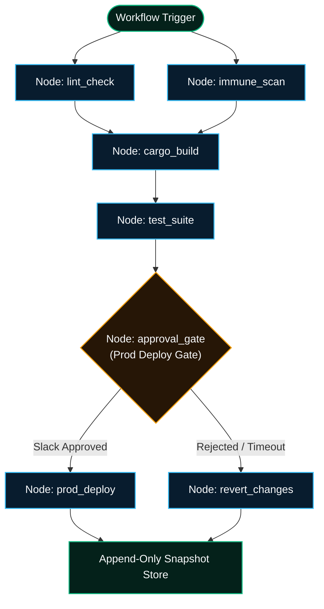

# `agent-spine` — Deterministic Workflow Engine

`agent-spine` is the orchestration engine for the Autonomic cluster. Instead of relying on probabilistic Python `while` loops to determine an agent's control flow, `agent-spine` forces multi-step procedures through strict, deterministic Directed Acyclic Graphs (DAGs) with **immutable state snapshots** and **Human-in-the-Loop (HITL) approval gates**.



---

## Architectural Invariants

### 1. Deterministic Execution over Improvisation
Ad-hoc prompts ("run lint, then tests, then build, then review") lack audit trails, concurrency discipline, and retry safety. `agent-spine` treats workflows as **declarative, version-controlled artifacts**. The LLM is invoked only to perform discrete tasks *within* a node; the DAG controls the topology, retries, and data passing.

### 2. Time-Travel Debugging via Immutable Snapshots
Before and after every node execution, `agent-spine` serializes the runtime state, environment variables, and filesystem diffs into an append-only SQLite/JSONL snapshot. If an agent hallucinates on Step 5 and breaks the build, operators can literally "rewind" the execution state to Step 4, tweak the prompt or parameters, and resume without re-running prior nodes.

### 3. Cryptographic Human-in-the-Loop (HITL) Gates
When a DAG reaches an `ApprovalGate`, `agent-spine` pauses execution. It dispatches a webhook event via `agent-mouth` to Slack/Discord containing the proposed diffs and waits for an authorized operator callback before proceeding.

---

## In-Depth Usage Guide

### 1. Authoring Workflow Definitions (`workflow.yaml`)

Workflows are declared using strict YAML schemas that validate dependency graphs, execution timeouts, retries, and failure handlers before any code runs:

```yaml
version: "1.0"
name: "ci-validation-and-release"
concurrency: 4

env:
  ENVIRONMENT: "staging"
  CARGO_TERM_COLOR: "always"

nodes:
  - id: "security_scan"
    action: "immune:scan_manifest"
    params:
      manifest: "Cargo.toml"
      block_on_cvss_above: 7.5
    timeout_seconds: 60

  - id: "lint_check"
    action: "muscle:execute_bash"
    params:
      command: "cargo clippy -- -D warnings"
    timeout_seconds: 120

  - id: "build_and_test"
    action: "muscle:execute_bash"
    depends_on: ["security_scan", "lint_check"]
    params:
      command: "cargo test --release"
    retries: 2
    retry_delay_seconds: 5
    timeout_seconds: 300

  - id: "prod_deploy_gate"
    type: "approval_gate"
    depends_on: ["build_and_test"]
    channel: "slack"
    title: "Production Release Approval"
    description: "Approve deployment of v1.0.0-beta.2 bottle to production cluster."
    timeout_minutes: 30

  - id: "deploy"
    action: "muscle:execute_bash"
    depends_on: ["prod_deploy_gate"]
    params:
      command: "cargo publish && git push origin --tags"
    timeout_seconds: 180

  - id: "rollback"
    action: "muscle:execute_bash"
    on_failure_of: ["deploy"]
    params:
      command: "git reset --hard HEAD~1"
```

### 2. Validating Workflow Acyclicity & Syntax

Before running a workflow in production, validate its graph structure against the `agent-spine` schema compiler:

```bash
# Validates DAG topology, detects circular dependencies, and verifies parameter types
agent-spine validate .autonomic/workflows/ci.yaml
```

**Expected Output:**
```
✓ Schema: Valid (v1.0 spec)
✓ Topology: 6 nodes, 0 cycles detected
✓ Critical Path: security_scan -> build_and_test -> prod_deploy_gate -> deploy (estimated 480s)
✓ Concurrency: 4 max parallel execution slots
```

### 3. Executing Workflows via CLI

You can trigger DAGs synchronously or as detached background tasks:

```bash
# Execute synchronously with live terminal progress
agent-spine run .autonomic/workflows/ci.yaml --meta "release-v1.0.0-beta.2"

# Execute in background with parameter overrides
agent-spine run .autonomic/workflows/ci.yaml \
  --param ENVIRONMENT=production \
  --param BATCH_SIZE=50 \
  --detach
```

### 4. Human-in-the-Loop (HITL) Approvals

When execution reaches an `approval_gate`, `agent-spine` enters the `WAITING_APPROVAL` state and broadcasts a webhook via `agent-mouth`. Operators can approve from Slack or directly via CLI:

```bash
# Check active approval requests
agent-spine approvals list

# Approve an active run gate
agent-spine approvals approve run-8924b1a --comment "Approved by DevOps on-call"

# Reject and trigger rollback DAG branch
agent-spine approvals reject run-8924b1a --reason "Pending security sign-off"
```

### 5. Time-Travel Debugging & Snapshot Recovery

Every node transition saves a bit-exact snapshot of the execution context to `~/.autonomic/spine/snapshots/`:

```bash
# Inspect snapshots for a specific workflow run
agent-spine snapshots list --run-id run-8924b1a

# Output:
# SNAPSHOT ID          STEP ID            STATUS     TIMESTAMP
# snap-01J9X1        security_scan       SUCCESS    2026-10-17 07:15:02 UTC
# snap-01J9X2        build_and_test      FAILED     2026-10-17 07:18:44 UTC

# Rewind to the pre-test snapshot and resume after fixing code
agent-spine resume run-8924b1a --from-snapshot snap-01J9X1
```

---

## MCP Tool Reference

`agent-spine` integrates natively into AI IDEs (Cursor, Claude, Antigravity) via Model Context Protocol:

### `spine_submit_workflow`
Submits a declarative YAML DAG payload and returns a unique `run_id`:

```json
{
  "name": "ci-pipeline",
  "workflow_yaml": "version: '1.0'\nnodes:\n  - id: test\n    action: muscle:execute_bash\n    params: { command: 'npm test' }",
  "meta": "feature-branch-verification"
}
```

### `spine_check_status`
Polls real-time step progress, stdout snippets, and approval gate status:

```json
{
  "run_id": "run-8924b1a"
}
```

**Response:**
```json
{
  "status": "WAITING_APPROVAL",
  "active_step": "prod_deploy_gate",
  "completed_steps": ["security_scan", "lint_check", "build_and_test"],
  "failed_steps": [],
  "approval_url": "https://hooks.slack.com/actions/...",
  "duration_seconds": 412
}
```

### `spine_list_workflows`
Lists all available predefined workflow blueprints registered in `.autonomic/workflows/`.
