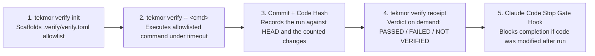

# tekmor documentation: proof eval, receipts, and stop gates

> Documentation for tekmor, the local-first proof evaluation engine and process stop gate for autonomous coding agents. Enforces allowlisted checks, code-hashed receipts, and hard process boundaries with 0 model calls.

`tekmor` is a single binary that makes autonomous coding agents follow your repository's rules and show verifiable proof of their work. When an agent like Claude Code runs tests through `tekmor verify`, the run is recorded with the HEAD commit and a hash of the uncommitted changes; `tekmor verify receipt` computes the verdict on demand. A process stop gate physically blocks the agent from completing its turn if it claims the tests pass without a `PASSED` receipt for the current code.



## Requirements

| Surface | Requirement | Notes |
| :--- | :--- | :--- |
| **Pre-built binary** | macOS 13+ (Apple Silicon arm64) | Distributed via Homebrew tap |
| **Source build** | Rust 1.80+ / Cargo | Compiles on Linux, macOS (x86_64 / arm64) |
| **Git integration** | Git | Receipts bind to the HEAD commit and uncommitted changes |
| **Host environments** | Claude Code; other agents and CI use the receipt | Claude Code gets native stop and bash hooks via `tekmor install` |

## Quickstart in 30 Seconds

### 1. Install tekmor

```bash
brew tap autonomic-ai-dev/tap
brew install autonomic-ai-dev/tap/tekmor
```

### 2. Connect Claude Code hooks

```bash
tekmor install
```

This registers the Stop gate and Bash gate hooks in `.claude/settings.json`.

### 3. Initialize allowlist

```bash
tekmor verify init
```

This creates `.verify/verify.toml` with an allowlist for your project.

### 4. Run an allowlisted check & read receipt

```bash
tekmor verify -- .verify/run.sh
tekmor verify receipt
```

---

## Core Invariants

1. **Zero Model Calls**: `tekmor` never calls an LLM or spends your API tokens. Validation is 100% deterministic local Rust process execution.
2. **Zero Network**: `tekmor` opens 0 network connections during verification, hook evaluation, or receipt computation.
3. **Receipts Bound to the Code**: Every run is tied to the exact commit and a hash of the counted changes. Any counted edit makes earlier runs stop counting.
4. **Hard Stop Gates**: The stop hook parses the agent's turn completion claim. A claim without a `PASSED` receipt is blocked at the process level.

---

## Documentation Guide

### Get Started
- [Installation](installation) — Homebrew tap, crates.io, source build, and per-host hook registration.
- [Verification and Receipts](verification) — Detailed breakdown of verdicts, the code hash, and CI verification.

### Reference
- [CLI Reference](cli) — Complete flag reference for `verify`, `--repeat`, `receipt`, `ratchet`, `drift`, and `check-checks`.
- [Known Limits](limits) — Explicit engineering boundaries, Keychain scoping, and arm64 architecture support.
