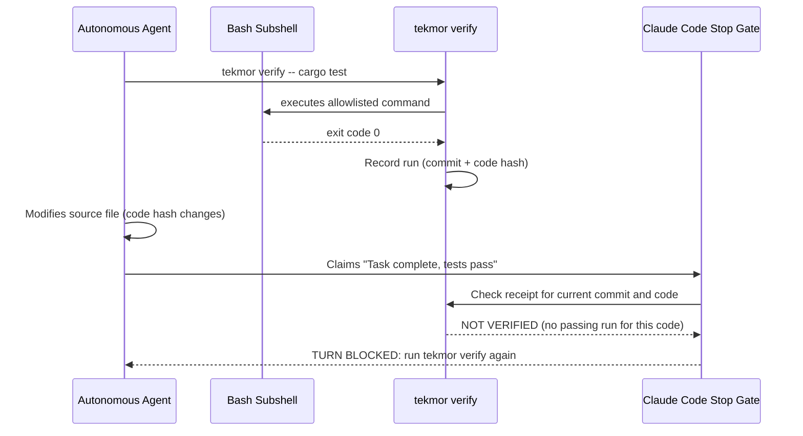

# Verification and receipts

> How tekmor binds test outcomes to the commit and a hash of uncommitted changes, detects flaky runs, and publishes receipts in CI.

A receipt answers one fundamental question: **Did the verification command pass for the exact commit and code state on disk right now?**

Language models frequently touch files _after_ running test suites—fixing typos, adjusting comments, or performing hasty refactorings. Even if an earlier test run exited 0, the code on disk is no longer verified. `tekmor` solves this by binding every run to the HEAD commit plus a hash of the uncommitted changes.



---

## Verdicts

`tekmor verify receipt` computes the verdict on demand from recorded runs and the current repository state:

| Verdict            | Exit Code | Meaning                                                                                          |  Proof Status   |
| :----------------- | :-------: | :----------------------------------------------------------------------------------------------- | :-------------: |
| **`PASSED`**       |    `0`    | An allowlisted command ran on the current commit and code state and exited 0.                    | **Valid Proof** |
| **`FAILED`**       |    `1`    | The latest run on this code exited non-zero. The receipt records the exit code and log artifact. |    Not Proof    |
| **`NOT VERIFIED`** |    `1`    | No passing run exists for this code, or the pass does not count (see below).                     |    Not Proof    |

> [!IMPORTANT]
> **Only `PASSED` counts as proof.** The Claude Code stop gate blocks turn completion when the receipt is not `PASSED`.

---

## What a Receipt Is Bound To

Every run is recorded against:

- **The HEAD commit** — a new commit makes earlier runs stop counting.
- **A code hash** — a SHA-256 over the paths and contents of the uncommitted changes reported by `git status`, untracked files included.

Excluded from the code hash: documentation (`*.md`, `*.rst`), `.verify/artifacts/`, `.verify/features/`, `.verify/knowledge-base/`, `.claude/`, and generated output (`target/`, `node_modules/`, caches). A clean tree hashes empty input. Editing a README does not invalidate a test pass; editing any counted file does.

A repository with no commits cannot reach `PASSED`.

---

## What Else Refuses PASSED

Even with a passing run on the current code, the receipt refuses `PASSED` when:

- **The run is flaky** — `tekmor verify --repeat N -- <cmd>` records $N$ runs; if they disagree, the command does not count as proof.
- **A review is missing** — a path in `.verify/review.toml` changed without a passing review recorded by `tekmor verify review`.
- **Tests were removed or disabled** — the uncommitted change removes or disables tests compared to HEAD, unless a pass review accepts it.

---

## Where Runs Are Stored

There is no `.verify/receipt.json` file. Runs are stored in the local store (`~/.autonomic/memory/data/brain.db` by default), and `tekmor verify receipt` computes the verdict on demand in three formats:

```bash
tekmor verify receipt            # text
tekmor verify receipt --markdown # formatted for PR comments / job summaries
tekmor verify receipt --json     # machine-readable
```

Text output:

```
Verify receipt: PASSED
  command:   sh -c true
  exit code: 0
  recorded:  2026-11-25T05:33:22Z
  source:    cli
  artifact:  .verify/artifacts/4b021624-7012-4e46-be36-7266dc289fa1.log
  commit:    2a424911d701
  code hash: e3b0c44298fc
```

JSON output:

```json
{
	"verdict": "passed",
	"head_sha": "2a424911d7015dc3f08987aaf8fe39f7cca3bacd",
	"code_hash": "e3b0c44298fc1c149afbf4c8996fb92427ae41e4649b934ca495991b7852b855",
	"evidence": {
		"id": "4b021624-7012-4e46-be36-7266dc289fa1",
		"cmd": "sh -c true",
		"exit_code": 0,
		"recorded_at": 1795584802888,
		"source": "cli",
		"artifact": ".verify/artifacts/4b021624-7012-4e46-be36-7266dc289fa1.log"
	}
}
```

A code state with no recorded run reports:

```
Verify receipt: NOT VERIFIED
  no verify run recorded for this commit and code state; run `tekmor verify -- <cmd>`
  commit:    2a424911d701
  code hash: ca0a49e77e8e
```

---

## CI Verification (ADR 0004)

In GitHub Actions, `.github/workflows/receipt.yml` reruns the allowlisted checks in CI:

1. CI does **not** trust local receipts created on developer machines.
2. The CI runner executes the allowlisted checks in a fresh environment.
3. The receipt is published in the job summary as the check "Verified receipt for this change".
4. Merges are blocked only if the repository makes that check required in branch protection.

## Next Step

- Read [CLI Reference](cli) for all flags and commands.
