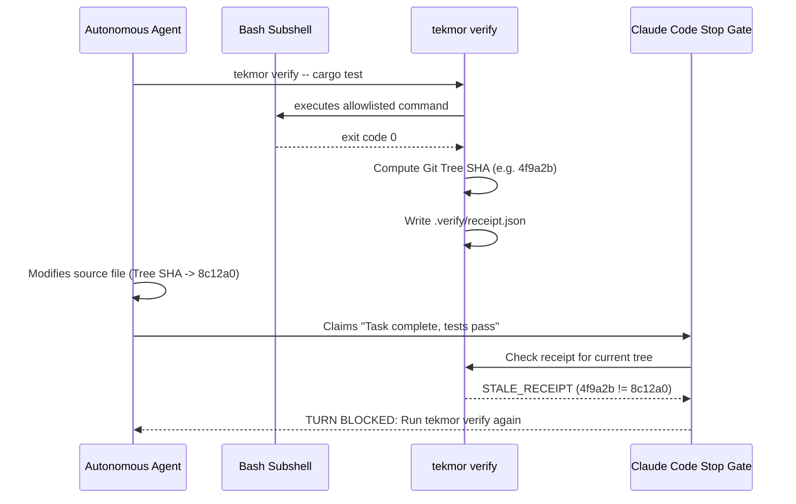

# Verification, receipts, and cryptographic tree hashing

> How tekmor binds test outcomes to git tree SHAs, detects stale evidence, eliminates flaky runs, and publishes cryptographic receipts in CI.

A receipt answers one fundamental question: **Did the verification command pass for the exact commit and code state on disk right now?**

Language models frequently touch files *after* running test suites—fixing typos, adjusting comments, or performing hasty refactorings. Even if an earlier test run exited 0, the code on disk is no longer verified. `tekmor` solves this by binding every receipt to a cryptographic hash of the entire git tree.



---

## Verdicts Matrix

`tekmor verify receipt` evaluates local execution artifacts against the current repository state:

| Verdict | Exit Code | Meaning | Proof Status |
| :--- | :---: | :--- | :---: |
| **`PASSED`** | `0` | The command ran on the current commit and code state, exited 0, and is non-flaky. | **Valid Proof** |
| **`FAILED`** | Non-zero | The most recent run for this tree exited non-zero. The receipt records the exact exit code and log artifact. | Not Proof |
| **`NOT VERIFIED`** | `1` | No run exists for this tree, or code was edited after the last test run (stale). | Not Proof |

> [!IMPORTANT]
> **Only `PASSED` counts as proof.** The Claude Code stop gate blocks turn completion if the receipt reports `FAILED` or `NOT VERIFIED`.

---

## How Tree Hashing Works

Instead of checking filesystem modification timestamps (`mtime`), which are notoriously noisy and unstable, `tekmor` calculates a cryptographic tree hash covering all project files that influence execution:

```rust
// Defined in tekmor/src/receipt.rs
pub struct Receipt {
    pub schema_version: String,
    pub command: String,
    pub exit_code: i32,
    pub git_commit: String,
    pub tree_sha: String,
    pub verdict: Verdict,
    pub recorded_at: String,
    pub artifact_path: Option<PathBuf>,
}
```

### Files Counted vs Ignored

- **Counted Files**: All source code under tracked directories (`src/`, `crates/`, `tests/`, `hooks/`, etc.), plus build manifests (`Cargo.*`, `package.json`, `verify.toml`).
- **Excluded Files**: Documentation files (`*.md`, `*.rst`), `.claude/` session state, `.verify/artifacts/` logs, and `.git/`. Editing a README or adding notes does not invalidate a test pass.

If any counted file is modified by even one byte, the tree SHA changes. `tekmor verify receipt` immediately flags the past run as `stale: true`, requiring the agent to re-run verification before claiming completion.

---

## Flaky Test Elimination (`--repeat N`)

A test that passes intermittently is not proof of correctness. When running verification with `--repeat`:

```bash
tekmor verify --repeat 3 -- cargo test
```

`tekmor` executes the command $N$ times consecutively on the identical git tree. If any iteration returns a non-zero exit code while another returns 0:
- The check is marked `FLAKY_DISAGREEMENT`.
- The command is excluded from generating a `PASSED` receipt.
- The Claude Code stop hook treats the check as unverified until the test flakiness is resolved.

---

## The `.verify/receipt.json` Schema

Receipts are persisted locally in `.verify/receipt.json`:

```json
{
  "schema": "v1.0.0",
  "command": "cargo test --all-features",
  "exit_code": 0,
  "git_commit": "a8f3b12c4",
  "tree_sha": "4f9a2b8e19c02d7e",
  "verdict": "PASSED",
  "source": "cli",
  "recorded_at": "2026-10-27T14:22:01Z",
  "artifact": ".verify/artifacts/run-a8f3b12c4.log",
  "stale": false
}
```

To display the receipt in formatted markdown for PR descriptions:

```bash
tekmor verify receipt --markdown
```

---

## CI Verification Strategy (ADR 0004)

In GitHub Actions CI pipelines, `tekmor` runs in clean-room mode via `.github/workflows/receipt.yml`:
1. CI does **not** trust local receipts created on developer machines.
2. The CI runner executes `tekmor verify -- .verify/run.sh` in a fresh environment.
3. The receipt output is appended directly to the GitHub Actions job summary (`$GITHUB_STEP_SUMMARY`).
4. Pull request merges are gated on the "Verified receipt for this change" status check.

## Next Step

- Read [CLI Reference](cli) for all flags and commands.
