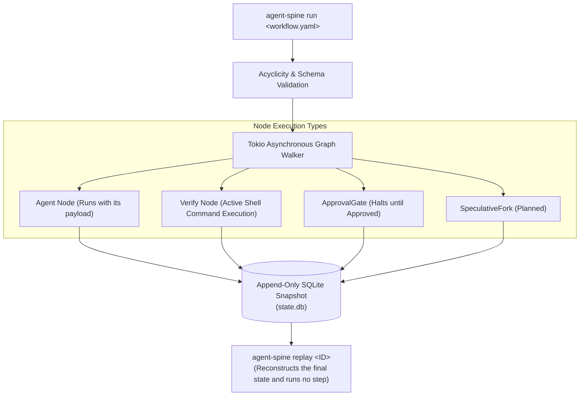

# thesmos documentation: deterministic DAG engine and state machine

> Documentation for thesmos (command: agent-spine), the declarative workflow DAG engine and cognitive state machine for coding agents. Combines YAML topologies, active verify nodes, and append-only SQLite snapshots.

`thesmos` replaces unbounded, hallucination-prone prompt loops with **declarative, version-controlled Directed Acyclic Graphs (DAGs)**, immutable snapshots, and human-in-the-loop gates. In this release, the CLI command is named `agent-spine`.

## Requirements

| Surface | Requirement | Notes |
| :--- | :--- | :--- |
| **Pre-built binary** | macOS 13+ (Apple Silicon arm64) | Distributed via Homebrew tap |
| **Source build** | Rust 1.80+ / Cargo | Compiles on Linux, macOS |
| **Storage engine** | SQLite 3 | Embedded locally in `~/.autonomic/logs/spine/state.db` |
| **Event broker** | NATS (Optional) | Used only when `AUTONOMIC_NATS_URL` is set; falls back to local DLQ |

## Core Invariants

1. **Declarative Control Flow**: Topologies are strictly declared in YAML files. The worker agent does not decide what happens next; the graph transitions do.
2. **Active Machine Validation**: `Verify` nodes asynchronously execute shell validation commands under timeouts, capturing stdout, stderr, and exit codes.
3. **Append-Only SQLite Snapshots**: Every state transition appends an immutable row to `state.db`. A completed execution is an audit trail, not an ungrounded summary.
4. **Declared Context**: `Agent` nodes receive the context in their payload. The `--brain` flag depends on the retired agent-brain.
5. **Replay Reads the Record**: `agent-spine replay <ID>` recreates the final state from SQLite snapshots and runs no step again.

---

## Documentation Guide

### Get Started
- [Installation](installation) — Single-binary Homebrew tap, global shell setup, and doctor diagnostics.
- [Workflows & Node Kinds](workflows) — Full YAML specification, the node kinds, and retry policies.

### Reference
- [agent-spine CLI](cli/agent-spine) — CLI options for `run`, `validate`, `inspect`, `replay`, and template scaffolding.
- [Design Decisions](decisions) — Rationale for append-only SQLite tables, local DLQ fallbacks, and the planned SpeculativeFork.
- [Troubleshooting](troubleshooting) — Dead-letter queue analysis (`dlq.jsonl`) and execution failure recovery.
